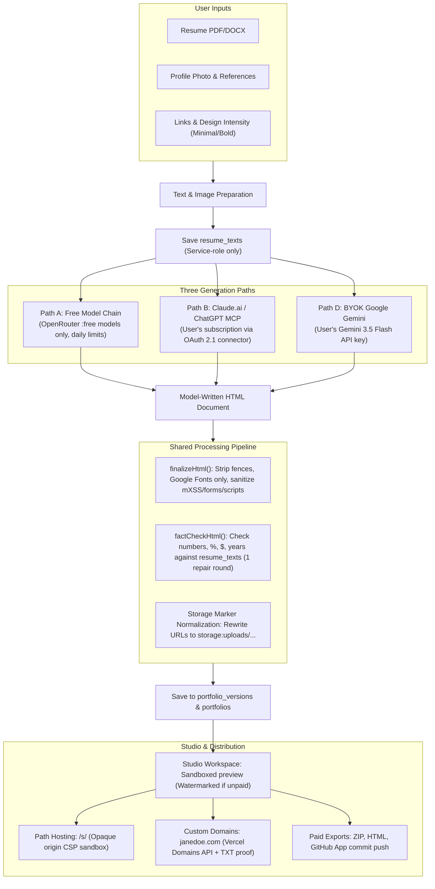
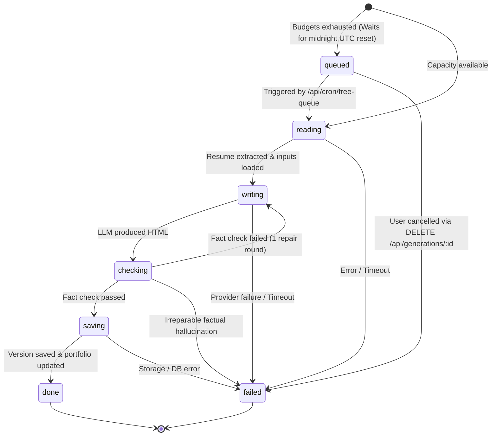
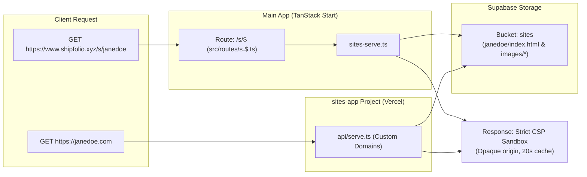
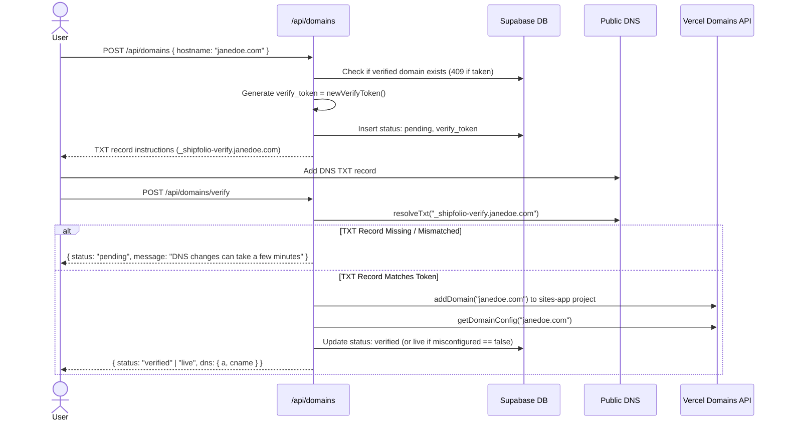
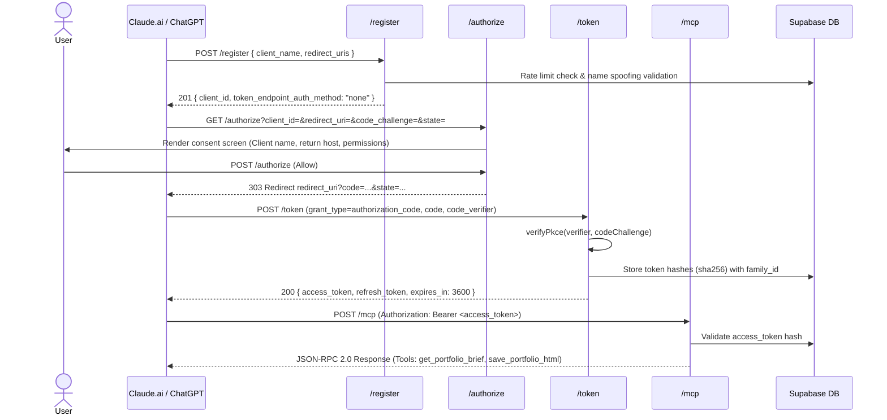

# Architecture & Security Specification

This document details the core system architecture, generation pipeline, security boundaries, hosting isolation, and database privilege model for **Shipfolio AI**.

---

## 1. High-Level Architecture & Three Generation Paths

Shipfolio supports three distinct generation paths. All paths bypass rigid JSON steps or static themes: the model writes a complete, bespoke HTML/CSS document directly, which passes through a shared verification and fact-checking pipeline.



### Path A: Free Model Harness
- **Harness:** Fallback chain across configured OpenRouter slots (`FREE_MODEL_OPENROUTER_A..D`).
- **Free-Models-Only Rule:** Enforced in code (`src/config/free-models.ts`). Every OpenRouter model ID **must end with `:free`** (e.g. `nvidia/nemotron-3-super:free`). Any model without the `:free` suffix is discarded at runtime so it can never bill the owner's OpenRouter account.
- **Quota & Cooldowns:** Shared daily provider budgets (`provider_budgets` table) and per-user daily generation limits (`FREE_GENERATIONS_PER_DAY`: 3 for free users, 10 for pro). If a provider returns 429, 500, or auth errors, it enters a temporary cooldown, allowing fallback to the next provider in the chain.

### Path B: Claude.ai & ChatGPT Connector (MCP)
- **Model Context Protocol (MCP):** Connects external AI desktop/chat clients (Claude.ai, ChatGPT) via Streamable HTTP at `/mcp`.
- **OAuth 2.1 & PKCE:** Dynamic client registration (`/register`), authorization consent screen (`/authorize`), and token grants (`/token`).
- **Execution:** The user's own subscription runs the model. MCP tools provide context and save results:
  - `get_portfolio_brief`: Supplies resume text, photo URL, visual references, links, and guardrail rules.
  - `save_portfolio_html`: Validates and sanitizes the generated HTML through `finalizeHtml()` and fact checking; returns `{ previewUrl }` or specific issues to repair.
  - `get_portfolio_html`: Retrieves the current HTML for revisions.
- **Deterrents:** Tool instructions instruct the model to return the Studio preview link rather than pasting the complete HTML in chat; clean exports, watermark removal, and custom domains remain paid.

### Path D: BYOK Google Gemini Key
- **Direct Integration:** Uses Google Gemini (`gemini-3.5-flash`) via the user's personal API key.
- **Key Security:** Envelope-encrypted using AES-256-GCM (`ENCRYPTION_KEY`) in `public.byok_keys`. Keys are decrypted only inside server handlers at generation time.

---

## 2. Background Job Lifecycle & Concurrency Model

All portfolio generations run as asynchronous jobs managed by `generation_jobs`.



### Lifecycle Rules:
1. **Concurrency Constraint:** Strictly **one active job per user**. `createJob` rejects overlapping requests with `409 job_in_progress` (returning the active `jobId`).
2. **State Progression:** `queued` → `reading` (extracting resume text) → `writing` (LLM generation) → `checking` (numeric fact checking) → `saving` (sanitization & version insertion) → `done` (or `failed`).
3. **Queue & Cron:** When free model daily budgets are exhausted, jobs are created with status `queued` and `retry_at` set to the next UTC midnight. Vercel Cron triggers `/api/cron/free-queue` daily at `10 0 * * *` (`Authorization: Bearer <CRON_SECRET>`), executing pending jobs within the `RUN_BUDGET_MS` execution window (270s).
4. **Cancellation:** Users can cancel active queued jobs at any time via `DELETE /api/generations/:id`.

---

## 3. Shared Processing & Security Verification Pipeline

Every generated HTML document passes through a rigorous sanitization and fact-checking pipeline before storage:

### A. HTML Sanitization (`src/server/finalize-html.ts`)
- **Tag Removal:** Prohibits `<script src="...">`, `<iframe>`, `<object>`, `<embed>`, `<base>`, `<meta http-equiv="refresh">`, and remote `<form>` actions. Small inline scripts for visual interactions and CSS animations are permitted.
- **mXSS Defense:** Multi-pass cleaning runs until the DOM tree reaches structural stability against mutational XSS injections.
- **Link Whitelisting:** Rewrites outgoing hyperlink `href` attributes to keep only URLs explicitly provided in `portfolio_inputs` (plus internal `#anchor` links and `mailto:`/`tel:` addresses verified from the resume). Unverified links have their `href` removed while retaining label copy.
- **Asset Restrictions:** Restricts external resources exclusively to Google Fonts (`https://fonts.googleapis.com` and `https://fonts.gstatic.com`). Remote external images are stripped; only user uploads and inline SVG/data URIs are permitted.
- **Storage Marker Translation:** Normalizes expiring signed Supabase Storage URLs into permanent storage markers (`storage:uploads/...`) before database insertion. When serving, markers are dynamically re-signed.

### B. Numeric Fact Checking (`src/server/fact-check.ts`)
- **No-Hallucination Guardrail:** Analyzes visible text in the generated HTML against extracted text saved in `resume_texts`.
- **Claim Extraction:** Extracts numbers, percentages, currency values, and calendar years.
- **Repair Round:** If claims appear in the HTML that cannot be substantiated by the resume text, an automated repair prompt is dispatched to the LLM with the exact unverified claims. If claims remain unresolved after repair, generation fails with `422 generation_unsupported_claims`.

### C. Server-Side Watermark Injection (`src/server/watermark.ts`)
- **Unpaid User Gating:** For users without paid access (`hasPaidAccess() === false`), `injectWatermark()` adds a persistent banner with `data-shipfolio-watermark`.
- **Integrity Guarantee:** Watermarks are injected server-side upon delivery (`GET /api/content`). The database copy (`portfolios.generated_html`) remains clean. When saving revisions, `finalizeHtml()` strips any existing watermark tags before re-sanitization.

---

## 4. Hosting & Sandbox Isolation Model

Shipfolio supports two hosting models: path-based hosting on the app domain (`/s/<slug>`) and custom domains (`janedoe.com`) via a separate Vercel project (`sites-app`).



### Opaque Origin Sandbox
To protect the main app's authentication cookies and session state, every response from `/s/*` and `sites-app` includes a strict Content Security Policy with `sandbox`:

```http
Content-Security-Policy: default-src 'none'; script-src 'unsafe-inline'; style-src 'unsafe-inline' https://fonts.googleapis.com; font-src https://fonts.gstatic.com; img-src 'self' data:; media-src 'self'; connect-src 'none'; form-action 'none'; frame-src 'none'; base-uri 'none'; sandbox allow-scripts allow-popups allow-popups-to-escape-sandbox
```

**Why `sandbox` without `allow-same-origin`?**
Omitting `allow-same-origin` forces the browser to treat the served page as having a unique, opaque origin (`origin: "null"`). Even though the page is served from the same domain (`shipfolio.xyz/s/<slug>`), client scripts running on the portfolio **cannot access `document.cookie` or localStorage** of the app domain. Any attempt to inspect cookies throws a `SecurityError`.

### Cache Control & Immediate Takedowns
All hosted responses specify:
```http
Cache-Control: public, max-age=0, s-maxage=20
```
This enables fast edge-caching on Vercel's CDN while ensuring that unpublishing or admin takedowns take effect globally within 20 seconds.

### Removing a site's files
`removeSiteFiles(admin, slug)` (`src/server/sites-storage.ts`) deletes everything under `sites/{slug}/` in Storage. It validates the slug first and never leaves that folder. It runs on a user's unpublish, an admin takedown, and before an account is deleted. On unpublish and takedown the site status flips first (so nothing is served immediately) and a clean-up failure is only logged; a daily job deletes sites that have been unpublished for 30 days together with any leftover files.

---

## 5. Custom Domain Verification & Ownership Proof

Custom domain attachment requires verified DNS proof before any domain is registered with Vercel or traffic is served.



### Protection Against Squatting
- **Pending Claims Prove Nothing:** Anyone can attempt to add a domain, but unverified `pending` claims do not grant ownership. If another user subsequently submits the same hostname, the pending claim is overwritten. Only domains that have achieved `verified` or `live` status are protected from duplicate claims.
- **Stale Record Cleanup:** A scheduled cron job (`/api/cron/domains`) runs daily at `20 0 * * *` via Vercel Cron to purge all pending domain records older than 14 days.

---

## 6. OAuth 2.1 & MCP Connector Security Model

The MCP connector enables external AI agents (Claude.ai, ChatGPT) to interact with Shipfolio via RFC 8414 / RFC 9728 standards.



### Security Guardrails:
1. **PKCE S256 Required:** All authorization requests must use `code_challenge_method: "S256"`. Plain authorization codes are strictly rejected.
2. **Name Spoofing Protection:** `/register` validates client names. Names imitating "Claude", "ChatGPT", or "Shipfolio" are rejected unless the registered redirect URI belongs to the respective official host (e.g. `claude.ai`, `chatgpt.com`). All zero-width and bidirectional override characters are stripped. Unverified apps display an explicit warning and return host on `/authorize`.
3. **Registration Rate Limiting:** Client registrations are capped at 300 per hour with unused registrations swept periodically.
4. **Hashed Token Storage:** All tokens (authorization codes, access tokens, and refresh tokens) are hashed via SHA-256 (`token_hash`) before insertion into `mcp_tokens`. Plaintext tokens are never stored.
5. **Rotating Refresh Tokens & Reuse Tolerance:**
   - Every refresh grant issues a new access token and rotating refresh token while invalidating the previous token.
   - A single `family_id` tracks the entire grant lineage.
   - **Reuse within 10 seconds:** Treated as an idempotent client retry (network glitch); the request is rejected without revoking the token family.
   - **Reuse after 10 seconds:** Detected as token compromise; the entire token family is immediately revoked.
6. **Request Size Cap:** `/mcp` checks `Content-Length` and rejects payloads exceeding 1 MB (`413 too_large`) before reading the request stream.

---

## 7. Database Privilege Lockdown & Table Inventory (Migrations 0001–0018)

### The Table Privilege Rule
Column-level `REVOKE` statements in PostgreSQL are ineffective if table-wide privileges are granted to `anon` or `authenticated`. Therefore, **every table must enforce complete privilege revocation**:

```sql
-- 1. Enable Row Level Security
alter table public.<table_name> enable row level security;

-- 2. Revoke all privileges from public roles
revoke all on public.<table_name> from anon, authenticated;

-- 3. Explicitly mediate all operations via service-role client scoped to AuthedContext.user.id
```

### Migration History & Table Inventory:

| Migration | Table / Feature | Security & Access Pattern |
|---|---|---|
| `0001_init.sql` | `users`, `portfolios`, `uploads`, `byok_keys`, `vercel_connections` | Core database schema. |
| `0002_retention_cron.sql` | `upload_deletion_warnings`, `app_config` | pg_cron schedules & retention configuration. |
| `0003_storage_cleanup.sql` | Storage purge routines | Edge Function webhook caller. |
| `0004_vercel_team_id.sql` | `vercel_connections.team_id` | Multi-team Vercel OAuth support. |
| `0005_payments.sql` | `purchases` | Records Dodo Payments transaction events. |
| `0006_admin_flag.sql` | `users.is_admin` | Superuser flag (hardened in 0010). |
| `0007_generated_html.sql` | `portfolios.generated_html` | Stores master clean HTML. |
| `0008_purge_orphaned_uploads.sql` | Cleanup functions | Orphaned upload purge triggers. |
| `0009_portfolio_inputs.sql` | `portfolio_inputs` | Stores wizard links, specifics, and design intensity. |
| `0010_lock_down_privileges.sql` | `users`, `portfolios` privilege lockdown | Fixed 0006 vulnerability. Revoked all direct access to `portfolios`. Restricted `users` table to `insert (id), update (id)`. All portfolio reads/writes mediated via service-role client. |
| `0011_portfolio_versions.sql` | `portfolio_versions` | Version history snapshots. RLS enabled, all privileges revoked from `anon` and `authenticated`. |
| `0012_resume_texts.sql` | `resume_texts` | Extracted resume text cache. RLS enabled, all privileges revoked from `anon` and `authenticated`. Cascades on upload deletion. |
| `0013_generation_jobs.sql` | `generation_jobs`, `provider_budgets` | Background job queue and daily shared provider quota tracking. RLS enabled, privileges revoked. |
| `0014_github_connections_exports.sql` | `github_connections`, `exports` | GitHub App installations and export audit log. RLS enabled, privileges revoked. |
| `0015_sites.sql` | `sites` | Subdomain & path-hosted sites registry. RLS enabled, privileges revoked. |
| `0016_mcp_oauth.sql` | `mcp_clients`, `mcp_tokens` | Dynamic clients and SHA-256 hashed OAuth tokens. RLS enabled, privileges revoked. |
| `0017_custom_domains.sql` | `custom_domains` | Custom domain hostnames, TXT tokens, and verification statuses. RLS enabled, privileges revoked. |
| `0018_retention_new_tables.sql` | Retention extensions | Cascade rules and cleanup triggers across generation jobs and site storage. |
