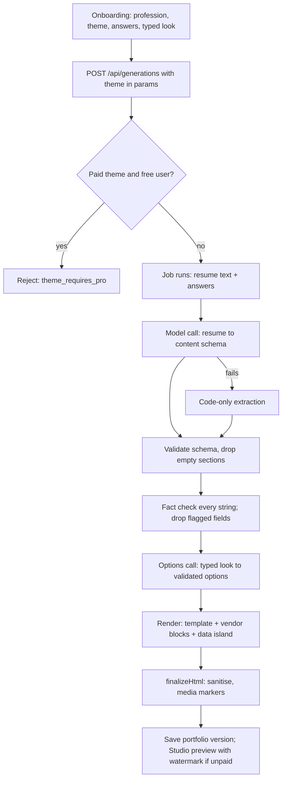

# Theme Templates with Customisation - Plan

## Goal Capsule

- **Objective:** A Shipfolio user can pick a designed theme for their profession and get a page that keeps that theme's design and signature interaction, carrying only their own resume facts, shaped by what they type. The same themes also guide custom builds.
- **Product authority:** The owner. This plan covers the 13-theme library, theme selection in onboarding, the background fill, typed customisation, free and paid rules, and themes as reference for the custom path. Generated photos or video, themes beyond the 13, and a visual theme editor are not active scope.
- **Means:** Each theme is a self-contained page skeleton with a data slot; server code fills the slot from the resume and answers (KTD1, KTD2).
- **Authority:** Product Contract wins on behaviour (R), Key Technical Decisions win on mechanism, units override neither.
- **Stop conditions:** Stop and report if a settled decision cannot work. If a theme cannot meet the Success Criteria, ship the finished themes and mark the rest not done (KTD9). Never apply a database change, deploy, or touch production settings.
- **Open blockers:** None block implementation. The owner settles four items before launch (see Outstanding Questions).

---

## Product Contract

### Summary

Shipfolio gains a library of 13 themes built from the Portfolio Wall sample sites, under new theme names and sample people, grouped by profession and tagged by feel. In onboarding a user picks a profession and a theme, answers a few short questions for the theme's signature feature, and can type look preferences. Their resume and answers fill the theme in the background. The themes also serve as reference material when a user takes the custom path and describes what they want built.

### Problem Frame

Today every Shipfolio user gets one model-written page. The owner compared that output with the 13 sample portfolios from the Portfolio Wall workshop and judged those designs, and their distinctive interactions, as clearly stronger. No evidence from Shipfolio users backs the gap; the benchmark is the owner's own quality bar.

The product has also taken a position against this. The README and `DESIGN.md` promise no fixed templates, and on 2026-10-11 the owner rejected a return to "structured content filled into templates" (`version2memory.md`). An earlier template renderer had been deliberately plain, which is part of why that approach was dropped. This plan reverses that decision for themes only, and keeps the bespoke path.

A practical pressure also exists. Free models cannot write a whole page in one call (`src/server/generation/pipeline/types.ts`), so a ready theme that needs only a short fill is a cheaper route to a polished result.

### Key Decisions

- KD1. **Reuse the sample sites' designs and code as closely as practical, under new theme names and sample people.** (session-settled: user-directed — chosen over original lookalikes: the owner states the templates are given to all workshop users to use as long as the names differ.) Governs R2.
- KD2. **Themes sit alongside the bespoke path; Custom stays available.** Chosen over making themes the default or replacing bespoke. Reverses the 2026-10-11 position. Governs R1, R6.
- KD3. **Signature features ask the user for their data and hide when empty.** Nothing is invented to make a theme look full. Governs R9, R10.
- KD4. **The gallery is organised by profession, tagged by feel.** Governs R3.
- KD5. **Typed preferences change look and sections only.** Governs R13, R14.
- KD6. **All 13 themes are required at launch.** The owner declined a staged release. Governs R5.
- KD7. **A few themes are free, the rest are paid.** Governs R17.

### Requirements

**Theme library**

- R1. Shipfolio offers 13 themes, one per sample site, alongside the existing custom generation.
- R2. Each theme keeps the original's design, structure and signature interaction as closely as practical, under a new theme name and a made-up sample person. No original persona name, photo, logo or text appears on any user's page.
- R3. Themes are grouped by profession (Product, Consulting, Operations, Marketing, Data, HR, Sales, Finance, Founder's Office), and each is tagged with its feel: Editorial, Playable, App-style or 3D. Each theme has one home profession. The owner sets the final theme and category names before launch.
- R4. Every theme has a live demo using its sample person, visible to all users whether the theme is free or paid.
- R5. All 13 themes are available at launch, including the 3D and game themes.

**Selection and flow**

- R6. Onboarding gains a theme step: the user picks a profession, then a theme from that profession's gallery with its live demo, or chooses Custom.
- R7. After choosing a theme, the user answers short questions for that theme's signature feature. Every question can be skipped.
- R8. A user can switch themes later. Their resume and typed answers carry over, and only the new theme's extra questions are asked.

**Content and facts**

- R9. The user's resume, their answers and their verified links fill the theme. Every fact on the page comes from those sources, under the same rule as bespoke pages.
- R10. A signature feature shows only data the user supplied. With none supplied, it hides and the rest of the page stays complete. No sample or placeholder data appears on a user's page.
- R11. A section with no data is hidden, and a theme without a photo or gallery still reads as designed.
- R12. All text a theme shows is fact-checked to the same standard as bespoke pages before the page is saved, including text the theme draws at runtime.

**Customisation**

- R13. The user can type preferences that change colours, fonts, mood, corner style, and which sections appear and in what order.
- R14. A typed request that would change the theme's structure or signature feature is declined for the theme and the user is offered the custom path.

**Custom path**

- R15. When a user takes the custom path, the themes are available to the model as design reference, and the result is a bespoke page, not a theme.

**Packaging**

- R16. Each theme is packaged as a reusable backend skill that defines its skeleton, the content it needs, its customisation options and its signature-feature questions, so a theme can be added or updated without changing the rest of the product.

**Tiers and publishing**

- R17. Free users can build and preview a small set of themes with the watermark. The remaining themes need payment. The owner sets which themes are free; the default is the lighter Editorial ones.
- R18. A themed page can be exported, pushed to GitHub, deployed and hosted like a bespoke page, and follows the same published-page safety rules.
- R19. The originals' voice-agent mascot is not included. Company greeting links (`?for=Company`) are kept.

### Key Flows

- F1. Build from a theme
  - **Trigger:** A user starts onboarding and reaches the theme step.
  - **Steps:** Pick profession; open a theme's demo; choose it; answer or skip the signature questions; optionally type look preferences; the page builds in the background and appears in the Studio with the watermark if unpaid.
  - **Outcome:** A themed page with only the user's own facts.
  - **Covered by:** R6, R7, R9, R10, R13
- F2. Typed preferences go too far
  - **Trigger:** A user types a request that restructures the theme.
  - **Steps:** The theme keeps its structure and applies the look and section changes it can; the user is offered Custom for the rest.
  - **Covered by:** R13, R14
- F3. Custom build with theme reference
  - **Trigger:** A user chooses Custom and types what they want.
  - **Outcome:** A bespoke page written with the themes as design reference.
  - **Covered by:** R15
- F4. Switch theme
  - **Trigger:** A user opens a different theme from the Studio.
  - **Outcome:** The page is rebuilt in the new theme from stored resume and answers; only new questions are asked.
  - **Covered by:** R8

### Acceptance Examples

- AE1. **Covers R10.** Given a user skips a theme's signature questions and their resume has no matching data, when the page builds, then the signature feature is hidden and the page shows no placeholder or sample content.
- AE2. **Covers R14.** Given a user types "turn this into a one-column timeline" for a theme with a fixed layout, when the page builds, then the theme layout is unchanged and the user is offered the custom path.
- AE3. **Covers R4, R17.** Given a free user opens a paid theme, when they view it, then they see the live demo with the sample person and cannot build it with their own resume until they pay.
- AE4. **Covers R12.** Given a theme draws a number at runtime that is not in the user's inputs, when the page is checked, then the build fails the fact check and the number does not reach a saved page.
- AE5. **Covers R11.** Given a user with no photo chooses a theme that normally shows a portrait, when the page builds, then the theme shows its no-photo design without an empty frame.

### Success Criteria

- For each of the 13 themes, the owner reviews it beside its original rendered with comparable content and agrees it is the same design and interaction.
- Rendering all 13 themes with sample resumes produces no number or claim that is absent from the inputs.
- Each of the 13 themes loads and works as a hosted page under the published-page safety rules (R18).

### Scope Boundaries

**Deferred for later**

- Generating photos or video for users.
- Themes beyond the 13.
- A visual theme editor.

**Not included**

- The originals' voice-agent mascot (R19) and the workshop's sample photos, videos and company logos.
- Changes to billing, pricing amounts or hosting.
- Building themed pages through the Claude or ChatGPT chat route. Themes run on the free-model and Gemini routes; the chat route only receives the design reference (R15, U13). Considered and not built: the chat route cannot call the fill step. Evidence that would change this: owners of chat-route users ask for themes there.

### Dependencies / Assumptions

- Assumption: the terms behind "given for all to use" cover a paid product. I have not seen them. The owner confirms with the Portfolio Wall author and keeps a copy.
- Assumption: free users see demos of paid themes but cannot build one with their own resume (AE3). The default free set is the lighter Editorial themes.
- Assumption: the 13 themes cover the nine professions with one home profession each, set from the sample sites' roles. Several professions have more than one theme.
- Verified: published pages allow only inline scripts, no network requests, no external scripts, and fonts only from Google Fonts (`src/server/site-csp.ts`). Each theme must be one self-contained page.
- Verified: the 3D and game samples carry about 670–800 KB of 3D library code each; the lighter samples carry about 130–190 KB.
- Verified: the fact checker ignores text inside script and style tags (`src/server/fact-check.ts`, `visibleText`), which is why R12 is a requirement.
- Verified: the only HTML size cap found is 600,000 characters on the Claude and ChatGPT save path (`src/server/mcp/tools.ts`). I found none on the main pipeline in `src/server` or `src/routes`.
- Unverified: how each theme looks and behaves when rendered. Interaction ideas were read from file and data names, not viewed in a browser.

### Outstanding Questions

**Owner input before launch (does not block implementation)**

- Final theme and category names. Working names in the code are placeholders.
- Which themes are free. The default is the lighter Editorial ones (R17).
- Written confirmation of the templates' terms of use from the Portfolio Wall author, kept on file (see Dependencies).
- GSAP licence: confirm the current GSAP licence permits use in a paid product before launch (U1 records the result).

### Sources / Research

- `README.md` line 5 and `DESIGN.md` ("Model Output Philosophy") hold the current no-templates positioning this plan reverses.
- `version2memory.md` (decision log, 2026-09-25 and 2026-10-11) records the move away from fixed templates and the rejection of a return to them.
- `src/server/generation/pipeline/types.ts` explains why free models need small steps.
- `src/server/generation/prepare.ts` shows the existing inputs: up to three reference images and the design intensity.
- `src/server/portfolio-inputs.ts` and `supabase/migrations/0009_portfolio_inputs.sql` hold today's stored user choices.
- The 13 sample sites are the owner's supplied Portfolio Wall zips; each has a "How to make it yours" guide that describes its content file and its signature feature.

---

## Planning Contract

### Key Technical Decisions

- KTD1. **A theme is a skeleton plus a JSON data island, not a model-written page.** Each theme page reads all its text from one `application/json` script block; server code writes that block. Serves R2, R9, R12. Rationale: one place holds every string a user sees, so one fact check covers the whole page, including text the theme script draws at runtime.
- KTD2. **Filling is code plus one bounded model call.** A model turns the resume into the content schema (the same free chain or Gemini key as bespoke builds); code validates it, fact-checks it, and renders. If the call fails, a code-only extraction from the resume lines fills what it can. Rationale: free models cannot write whole pages (`src/server/generation/pipeline/types.ts`), but they can fill a short, schema-bound extraction.
- KTD3. **Fact check runs on the content, not the rendered script.** Every string in the data island is checked with `findUnsupportedClaims` against the resume, links and answers (R12). A flagged field is dropped, not rewritten; a flagged name or role fails the build. Theme scripts may format and animate supplied strings but may not generate digits or words. A browser test reads the rendered text and fails on any digit not in the island (AE4).
- KTD4. **Theme identity lives in job params and in the saved page, so no database change is needed.** The chosen theme and answers travel in `generation_jobs.params` (an existing JSON column). The saved page carries a `shipfolio-theme` meta tag and its own data island, which Studio reads to show the current theme and to switch themes (R8) without stored state. Considered and not built: a `theme_id` column on `portfolios`. Evidence that would change this: the owner wants to filter or report on themes in SQL. If so, draft it into `supabase/pending/` only.
- KTD5. **Theme packages live under `src/server/themes/<theme-id>/`.** Each holds a manifest (name, profession, feel, tier, ready flag, sections, signature questions, allowed look options), the page template, a sample persona for the demo, and a short design reference for the custom path (R15, R16). Adding a theme means adding a folder and one registry line.
- KTD6. **Vendor libraries are bundled once from official npm packages into inline scripts.** A repo script builds `gsap`, `three` and `lenis` (pinned versions) into minified inline blocks with licence banners, committed under `src/server/themes/vendor/`. A manifest lists which blocks a theme inlines. Rationale: published pages allow inline scripts only (`src/server/site-csp.ts`). Rejected: external script tags, which `finalizeHtml` removes.
- KTD7. **Typed preferences become a validated options object.** A model call turns the user's text into the manifest's allowed options (colour variables as hex, fonts from a Google Fonts allow-list, corner style, mood, section order and visibility). Anything outside the allowed set is returned as `declined` and shown with an offer of Custom (R13, R14, AE2). The data island carries the options; the theme applies them as CSS variables and section order.
- KTD8. **Tier enforcement is server-side at build time.** `POST /api/generations` rejects a paid theme for a user without `hasPaidAccess` (`src/server/users.ts`). Demos are open to all. Export, publish and deploy keep their existing gates (R17, R18, AE3).
- KTD9. **A theme ships only when marked `ready`.** The flag is set after a Brave render beside the original sample passes. The catalog lists only ready themes, so an unfinished theme never reaches users. This is how the owner's "ship the done ones" rule is enforced in code.
- KTD10. **The watermark stays an overlay added at serve time.** `addWatermark` inserts a fixed bar with the maximum z-index before `</body>` (`src/server/watermark.ts`), so it needs no theme cooperation. Each interactive theme is checked in a browser to confirm it stays visible above canvases.

### High-Level Technical Design



### Output Structure

```text
src/server/themes/
  types.ts            content schema, manifest, options types
  registry.ts         theme list, ready filter, tier lookup
  content.ts          resume to content, answers merge, empty-section pruning
  fact.ts             content text for the fact check, field dropping
  options.ts          typed preferences to validated options
  render.ts           template + vendor + island assembly
  run.ts              theme build used by the job runner
  vendor/             inline library blocks (gsap, three, lenis) with licences
  <theme-id>/         manifest.ts, template.html, sample.ts, reference.md (x13)
scripts/build-theme-vendor.mjs
```

### Assumptions

- Each sample site's design can be reproduced as a template whose text all comes from the data island. Interaction code that invents text is rewritten to use supplied strings (KTD3).
- The 13 themes' roster, one home profession each and feel tags, is taken from the sample folders and "How to make it yours" guides in U1, with placeholder new names.
- Size is acceptable: the main pipeline has no HTML cap, and the 3D themes inline about 700 KB of library code. U11 measures real load time in the Studio preview and a hosted page.
- Skipped or empty answers need no stored data: they leave fields out of the island.

### Risks and Dependencies

- **Terms of use unverified.** The owner confirms with the Portfolio Wall author and keeps a copy before launch. Implementation proceeds on the owner's statement.
- **GSAP licence.** U1 checks the current GSAP licence text for commercial use and records the result. If unresolved, the PR flags it and GSAP-dependent themes are marked not ready.
- **Fidelity.** Matching "99% similar" depends on rendering. U8 to U11 each end with a side-by-side browser comparison; a theme that fails is marked not ready (KTD9).
- **Inline script round trip.** `finalizeHtml` re-parses the page up to four times; an 800 KB script must come back byte-identical. U4 tests this.
- **3D and game themes on weak devices.** Each must show a readable static fallback when WebGL is unavailable (U11).

### System-Wide Impact

- Generation: `src/server/generation/run-job.ts` gains a theme branch; bespoke branches are untouched.
- Free quota: a themed free build counts as a free run like any other (`src/server/generation/limits.ts`).
- Studio: loads themed pages the same way (`src/routes/api/content.ts`); the preview iframe already allows scripts (`src/components/preview/LivePreview.tsx`).
- Docs: `README.md` line 5 and `DESIGN.md` "Model Output Philosophy" state the old position; U13 updates only those passages and the PR lists them.

---

## Implementation Units

| U-ID | Title | Key files | Depends on |
|---|---|---|---|
| U1 | Theme package contract, registry, vendor, roster | `src/server/themes/types.ts`, `registry.ts`, `scripts/build-theme-vendor.mjs` | none |
| U2 | Content extraction and answers | `src/server/themes/content.ts` | U1 |
| U3 | Content fact check | `src/server/themes/fact.ts` | U1, U2 |
| U4 | Renderer and published-page safety | `src/server/themes/render.ts` | U1, U3 |
| U5 | Look preferences | `src/server/themes/options.ts` | U1 |
| U6 | Build path, API and tier gate | `src/server/themes/run.ts`, `src/server/generation/run-job.ts`, `src/routes/api/generations.ts` | U2 to U5 |
| U7 | Catalog and demo endpoints | `src/routes/api/themes.ts`, `src/routes/api/themes.$id.demo.ts` | U1, U4 |
| U8 | Editorial themes | `src/server/themes/<id>/` | U4 |
| U9 | App-style themes | `src/server/themes/<id>/` | U4 |
| U10 | Playable themes | `src/server/themes/<id>/` | U4 |
| U11 | 3D themes | `src/server/themes/<id>/` | U4 |
| U12 | Onboarding theme step and Studio switch | `src/routes/onboarding.tsx`, `src/components/studio/` | U6, U7 |
| U13 | Custom-path reference and docs | `src/server/generation/prepare.ts`, `README.md`, `DESIGN.md` | U8 to U11 |

### U1. Theme package contract, registry, vendor, roster

**Goal:** Define what a theme is, so later units only add folders.
**Requirements:** R1, R3, R16, KD2; KTD5, KTD6, KTD9.
**Dependencies:** none.
**Files:** `src/server/themes/types.ts`, `src/server/themes/registry.ts`, `src/server/themes/registry.test.ts`, `scripts/build-theme-vendor.mjs`, `src/server/themes/vendor/`, `docs/themes/roster.md`, `package.json`.
**Approach:**
- Define the content schema (profile, experience, projects, skills, education, links, signature answers), the manifest (id, placeholder name, profession, feel, tier, `ready`, sections, questions, allowed options, vendor list) and the options type.
- Read the 13 sample folders and their guides, read-only, and write `docs/themes/roster.md`: sample folder, new working name, home profession, feel, signature feature, questions it needs.
- Add pinned `gsap`, `three`, `lenis` as dev dependencies and write the script that bundles each into an inline block with its licence banner. Record each licence result, including GSAP, in `docs/themes/roster.md`.
- Registry returns only `ready` themes to callers and resolves tier by id.
**Patterns to follow:** config shape in `src/config/plans.ts`.
**Test scenarios:**
- A manifest with an unknown profession or feel fails validation.
- Registry hides a theme whose `ready` flag is false and still resolves it by id for tests.
- Every manifest's `vendor` entries exist as files; a missing one fails.
- No file under `src/server/themes/` contains any original persona name from the roster's "do not ship" list.
**Verification:** Registry tests pass; vendor script output exists with licence banners; roster lists 13 themes with one home profession each.

### U2. Content extraction and answers

**Goal:** Turn resume text and answers into the content schema with no invented data.
**Requirements:** R7, R9, R10, R11; KTD2.
**Dependencies:** U1.
**Files:** `src/server/themes/content.ts`, `src/server/themes/content.test.ts`.
**Approach:**
- Build the extraction prompt from the resume lines (`resumeLines` in `src/server/generation/pipeline/plan.ts`) and the manifest's sections; ask for the schema only, never prose pages.
- Parse and validate the reply; on failure run a code-only extraction using the existing fallback helpers (`fallback-render.ts`).
- Merge signature answers by key; prune sections and the signature feature when empty (R10, R11).
**Patterns to follow:** `parsePlan` and `completePlan` in `src/server/generation/pipeline/plan.ts`.
**Test scenarios:**
- Covers AE1. Resume with no matching data and skipped questions yields no signature data and no placeholder strings.
- Malformed model JSON falls back to code extraction and still yields name and experience.
- A user with no photo yields a content object with no photo field (AE5 input).
- An answer that repeats a resume fact is kept once.
**Verification:** Tests pass using a fake model; no network.

### U3. Content fact check

**Goal:** Guarantee every string on a themed page is supported by the inputs.
**Requirements:** R9, R12; KTD3.
**Dependencies:** U1, U2.
**Files:** `src/server/themes/fact.ts`, `src/server/themes/fact.test.ts`.
**Approach:**
- Put the content's strings into a plain text form and call `findUnsupportedClaims` (`src/server/fact-check.ts`) with the reference text built as in `prepareGeneration` plus answers.
- Drop the flagged field; fail with `generation_unsupported_claims` when a required field (name, role) is flagged.
**Test scenarios:**
- Covers AE4. A content string with "40%" absent from inputs is dropped and never reaches the render step.
- A number present in the resume passes.
- A flagged name fails the build with the existing error code.
- A user answer containing a number counts as supported, because it is an input.
**Verification:** Tests pass; error codes match `CHECK_FAILED` in `src/server/generation/run-job.ts`.

### U4. Renderer and published-page safety

**Goal:** Produce one self-contained page that passes `finalizeHtml` and the site CSP.
**Requirements:** R2, R12, R18; KTD1, KTD6.
**Dependencies:** U1, U3.
**Files:** `src/server/themes/render.ts`, `src/server/themes/render.test.ts`.
**Approach:**
- Assemble template, listed vendor blocks, and the data island (escape `<` and U+2028/U+2029 in the JSON), and add the `shipfolio-theme` meta tag.
- Pass the result through `finalizeHtml` with the user's links and storage markers; photos use `` with the storage marker.
- State the theme script rule: text comes from the island only (KTD3).
**Test scenarios:**
- Inline vendor script comes back byte-identical after `finalizeHtml`'s repeated parsing.
- Island text containing `</script>` or `<!--` cannot break out of the block.
- No `script[src]`, external link or iframe survives; all assets are inline or Google Fonts.
- A photo marker for another user's path is removed by `finalizeHtml`.
**Verification:** Tests pass; one fake vendor block of about 800 KB round-trips in reasonable time.

### U5. Look preferences

**Goal:** Turn typed text into allowed options and decline the rest.
**Requirements:** R13, R14; KD5; KTD7.
**Dependencies:** U1.
**Files:** `src/server/themes/options.ts`, `src/server/themes/options.test.ts`.
**Approach:**
- Prompt a model with the manifest's allowed variables, fonts and sections; validate hex colours, fonts against the allow-list, and section ids against the manifest.
- Return `{options, declined[]}`; with no model available return empty options and the whole request as declined.
**Test scenarios:**
- "Warm orange accent, rounded corners, hide projects" sets the accent variable and corners and hides one section.
- Covers AE2. "One-column timeline" for a fixed-layout theme yields no layout change and a declined entry.
- A font outside the allow-list is dropped.
- A script-like string in a colour field is rejected.
**Verification:** Tests pass with a fake model.

### U6. Build path, API and tier gate

**Goal:** Let a user start a themed build, gated by tier, inside the existing job system.
**Requirements:** R6, R7, R8, R17; KTD4, KTD8.
**Dependencies:** U2 to U5.
**Files:** `src/server/themes/run.ts`, `src/server/generation/run-job.ts`, `src/server/generation/jobs.ts`, `src/routes/api/generations.ts`, `src/server/themes/run.test.ts`, `src/routes/api/generations.theme.test.ts`.
**Approach:**
- Accept an optional `theme` object (id, answers, typed preferences) on `POST /api/generations`; validate id and sizes; store it in job params.
- Reject a paid theme for a user without `hasPaidAccess`, and an unknown or not-ready id.
- In `run-job.ts`, branch to the theme build when params carry a theme; save through `savePortfolioVersion` with a model string that names the theme.
- For a switch, accept a content seed read from the current page's island; ask only for new answers.
**Execution note:** Use fakes for Supabase and models; do not touch the real database.
**Patterns to follow:** validation and error shape in `src/routes/api/generations.ts`.
**Test scenarios:**
- Covers AE3. A free user posting a paid theme gets `theme_requires_pro` and no job is created.
- A paid user posting the same theme creates a job with theme params.
- An unknown theme id returns `invalid_request`.
- A theme build failing the fact check ends the job failed with the existing unsupported-claims message.
- Bespoke generation without a theme behaves exactly as before.
- A switch with a seed keeps resume facts and answers in the new page.
**Verification:** New tests and the existing generation tests pass.

### U7. Catalog and demo endpoints

**Goal:** Let the UI list themes and show each live demo.
**Requirements:** R3, R4, R5; AE3.
**Dependencies:** U1, U4.
**Files:** `src/routes/api/themes.ts`, `src/routes/api/themes.$id.demo.ts`, `src/routes/api/themes.test.ts`.
**Approach:**
- Catalog returns ready themes grouped by profession with feel tag, name, tier, a `locked` flag for the caller, and the questions.
- Demo renders the theme with its sample persona and serves it with the site CSP headers for a sandboxed iframe.
**Test scenarios:**
- A free user sees paid themes with `locked: true` and can fetch their demo.
- Not-ready themes are absent from the catalog and return 404 on demo.
- The demo response carries the site CSP.
**Verification:** Tests pass.

### U8. Editorial themes

**Goal:** Port the lighter Editorial themes (the default free set) with their signature interactions.
**Requirements:** R2, R5, R10, R11, R19; KD1; KTD1, KTD3, KTD9.
**Dependencies:** U4.
**Files:** `src/server/themes/<id>/` for each Editorial theme, `src/server/themes/themes.render.test.ts`.
**Approach:**
- For each theme: copy the sample's structure, styles and interaction into `template.html`; replace every hard-coded string and persona with island-driven text; drop sample media and the voice-agent widget; keep `?for=Company` greetings; write the manifest and a made-up sample persona.
- Render with the sample persona and with a minimal resume in Brave; compare with the original; set `ready` only if design and interaction match.
**Execution note:** Browser-verify every theme before setting `ready`; never run any script from the sample folders.
**Test scenarios:**
- Rendered text with a minimal resume contains no persona name from the "do not ship" list.
- Covers AE1. The signature feature is hidden with no answers and shown with answers.
- Covers AE5. A no-photo render shows the no-photo design without an empty frame.
- Browser: no network requests, and every digit in rendered text appears in the island (AE4).
**Verification:** Side-by-side screenshots kept outside the repo; each theme's status recorded in `docs/themes/roster.md`.

### U9. App-style themes

**Goal:** Port the App-style themes the same way.
**Requirements:** as U8.
**Dependencies:** U4.
**Files:** `src/server/themes/<id>/` for each App-style theme.
**Approach:** As U8. Their signature features (boards, pickers, streams) take user data from answers and hide when empty.
**Test scenarios:** As U8, plus each signature interaction works with user-supplied data and renders no placeholder rows when empty.
**Verification:** As U8.

### U10. Playable themes

**Goal:** Port the Playable themes the same way.
**Requirements:** as U8.
**Dependencies:** U4.
**Files:** `src/server/themes/<id>/` for each Playable theme.
**Approach:** As U8. Game or toy mechanics may use only supplied strings for labels and scores.
**Test scenarios:** As U8, plus the mechanic never displays a number that is not in the island.
**Verification:** As U8.

### U11. 3D themes

**Goal:** Port the three.js themes so they run inside one published page.
**Requirements:** R5, R18; KTD6, KTD10.
**Dependencies:** U4.
**Files:** `src/server/themes/<id>/` for the 3D themes, `src/server/themes/vendor/`.
**Approach:**
- Inline the pinned three.js block; replace sample models and textures with generated geometry or inline data.
- Add a static readable fallback when WebGL is unavailable.
- Measure page size and time to first render in the Studio preview and a hosted page.
**Test scenarios:**
- The page renders and animates in Brave with no network requests.
- With WebGL disabled the fallback shows all text content.
- The free-user watermark stays visible above the canvas (KTD10).
- Page size and load time are recorded; if unacceptable the theme is marked not ready and reported.
**Verification:** As U8, with size and fallback measurements in the PR.

### U12. Onboarding theme step and Studio switch

**Goal:** Let users choose, answer, type, and later switch.
**Requirements:** R6, R7, R8, R13, R14; F1, F2, F4.
**Dependencies:** U6, U7.
**Files:** `src/routes/onboarding.tsx`, `src/components/onboarding/ThemeStep.tsx`, `src/components/onboarding/ThemeStep.test.tsx`, `src/components/studio/StudioToolbar.tsx`.
**Approach:**
- Add a theme step before "Specifics": profession tabs, theme cards tagged by feel with the live demo in a sandboxed iframe, a Custom card, skippable signature questions, and one text box for look and sections.
- Show locked themes with the demo and an upgrade prompt, and surface `declined` results with the Custom offer.
- Add a "Change theme" action in the Studio toolbar that reuses the step with only new questions.
**Test scenarios:**
- Choosing Custom leaves the existing flow unchanged.
- A locked theme can be previewed but its build button is replaced by the upgrade prompt.
- Skipping every question still submits.
- Switching theme asks only the questions the new theme adds.
**Verification:** Component tests pass; a Brave run of the flow with a throwaway test user, created and deleted through the admin API per the repo's browser-testing notes.

### U13. Custom-path reference and docs

**Goal:** Feed theme design knowledge to custom builds and align the docs.
**Requirements:** R15; KD2.
**Dependencies:** U8 to U11.
**Files:** `src/server/generation/prepare.ts`, `src/server/mcp/tools.ts`, `src/server/generation/prepare.test.ts`, `README.md`, `DESIGN.md`.
**Approach:**
- Append a short design reference (from each theme's `reference.md`, chosen by profession and typed feel words) to the bespoke prompt and to the MCP guidance; guardrail rules and resume-only facts are unchanged.
- Edit only `README.md` line 5 and the `DESIGN.md` "Model Output Philosophy" passage to say themes exist alongside bespoke pages; the PR lists the exact edits.
**Test scenarios:**
- Covers F3. A custom build prompt includes a reference for the matching profession and still contains the guardrail text.
- No reference text contains persona names from the "do not ship" list.
**Verification:** Tests pass; the PR description lists the doc edits.

---

## Verification Contract

| Gate | Command or check | Applies to |
|---|---|---|
| Unit tests | `npm test` | all units |
| Lint | `npm run lint` | all units |
| Build | `npm run build` | all units |
| Theme render | Brave via playwright-core, per the browser-testing notes: render each theme with its sample and a minimal resume, compare with the original sample, scan rendered text for digits and persona names, check no network requests | U8 to U11 |
| Flow | Brave run of onboarding and Studio with a throwaway test user, deleted afterwards | U12 |
| Database | No migration is applied. Code and tests use fakes. `supabase/pending/` gets no new file unless KTD4's evidence appears | all units |

---

## Definition of Done

- Every theme marked `ready` was rendered in Brave and compared with its sample; every other theme is listed as not done in the PR.
- No original persona name, photo, logo, sample media or voice-agent widget exists in shipped code or on any user page.
- Rendering all ready themes with sample resumes shows no digit absent from the inputs.
- Tier gating, demos, onboarding step, Studio switch and the custom-path reference work as the units state.
- The PR lists the doc edits, the licence check results (GSAP included), the owner decisions still needed, and that no database change was made.
- Dead-end experiments and unused vendor files are removed from the diff.
