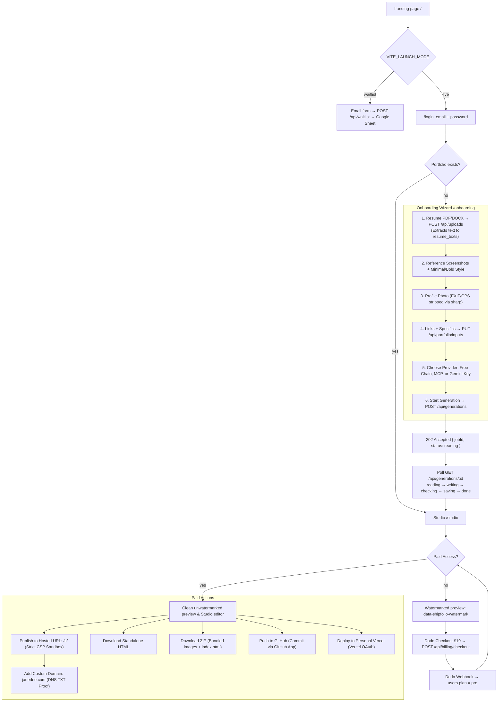
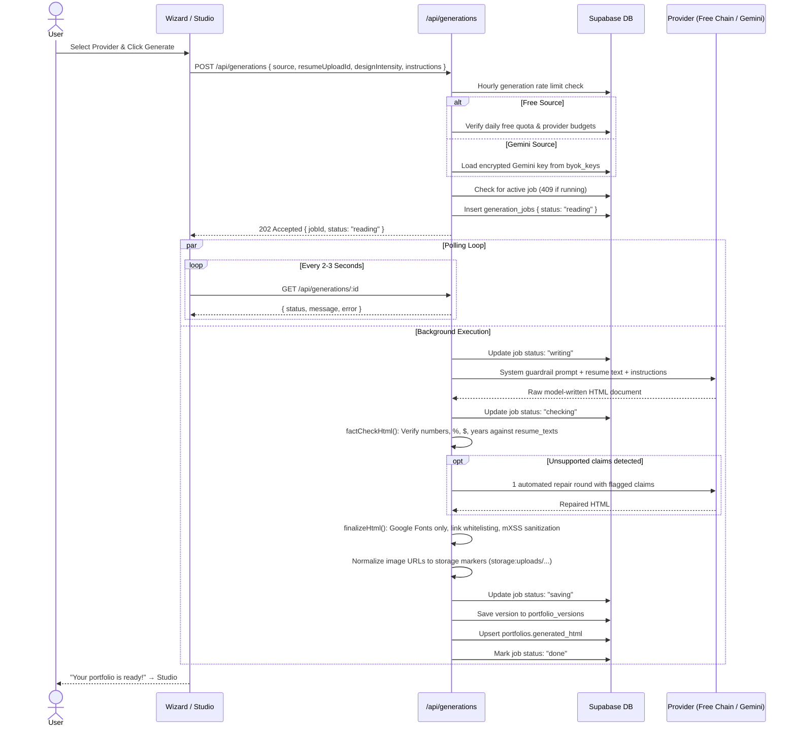
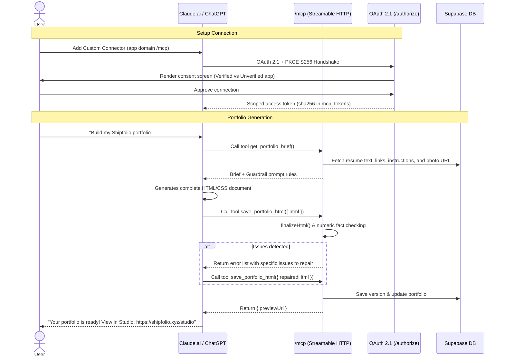
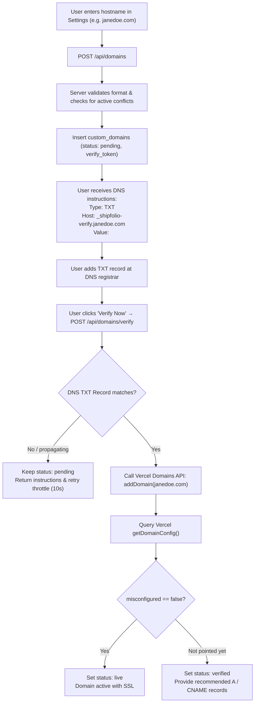

# User Flow: Current and Target Architecture

Status as of 2026-10-14.

- **Part 1** describes how the product works today, traced directly through the implemented code on `main`.
- **Part 2** reviews the Version 2 architecture specified in `version2memory.md` section 6 and documents the implementation status of each component (highlighting what has shipped vs. what remains).

---

# Part 1: Current Flow (As Built)

Shipfolio turns a resume into a bespoke, self-contained HTML/CSS portfolio website. Generation is handled asynchronously via background jobs across three distinct generation paths. Unpaid users receive a watermarked preview; paid access ($19 one-time Pro unlock via Dodo Payments) unlocks clean HTML, ZIP download, direct GitHub repository push, Vercel OAuth deployment, path/subdomain hosting, and custom domain configuration.

## Diagram: Current User Journey

## Diagram: Generation Request in Detail

---

## Stage-by-Stage Breakdown

### Stage 0: Landing Page (`/`)
- `getLaunchMode()`: When `VITE_LAUNCH_MODE=waitlist`, marketing CTAs open an email-capture modal submitting to `POST /api/waitlist` (forwarded to Google Apps Script). In `live` mode, CTAs route directly to `/login`.

### Stage 1: Authentication (`/login`)
- Email and password authentication via Supabase Auth (`supabase.auth.signUp`, `supabase.auth.signInWithPassword`).
- Successful authentication routes to `/studio` if content exists, or `/onboarding` for new users.
- Protected by global CSRF Origin validation in `src/start.ts`.

### Stage 2: The Multi-Step Wizard (`/onboarding`)
1. **Resume Upload:** `POST /api/uploads` (kind `resume`, PDF/DOCX, 5 MB limit). Magic bytes verified via `file-type`, text extracted and stored in `resume_texts` (accessible exclusively via service-role client).
2. **Visual Style & References:** Up to 3 reference screenshots uploaded via `POST /api/uploads` (kind `visual_reference`) plus Minimal vs. Bold intensity selection.
3. **Profile Photo:** Uploaded via `POST /api/uploads` (kind `photo`, PNG/JPEG/WEBP, 5 MB). Metadata and GPS EXIF data stripped via `sharp`.
4. **Links & Specifics:** LinkedIn, GitHub, project URLs, and custom instructions saved to `portfolio_inputs` via `PUT /api/portfolio/inputs`.
5. **Provider Selection:** Choose between:
   - ⚡ **Free Chain:** Zero setup, uses OpenRouter `:free` model harness.
   - 💬 **Claude / ChatGPT:** Custom MCP connector via `/connect` and `/mcp`.
   - 🔑 **Google Gemini:** BYOK key saved to `byok_keys` with AES-256-GCM encryption.
6. **Generate:** Dispatches `POST /api/generations`, returning `202 Accepted` with a `jobId`. Wizard displays a pulsing ambient `FluidOrb` and live status messages (`reading` → `writing` → `checking` → `saving` → `done`).

### Stage 3: Studio Workspace (`/studio`)
- Renders portfolio preview in an isolated iframe with `sandbox="allow-scripts"` (strictly omitting `allow-same-origin`).
- Unpaid users receive server-watermarked HTML (`data-shipfolio-watermark`).
- Studio toolbar supports direct visual inspection, mobile/tablet/desktop viewports, version history browsing, rollback (`POST /api/portfolio/versions/:id/restore`), and quick edit instructions.

### Stage 4: Payments & Access Control (Dodo Payments)
- One-time $19 lifetime Pro unlock via `POST /api/billing/checkout`.
- Webhook `POST /api/webhooks/dodo` validates standard HMAC signatures, activates `users.plan = 'pro'`, and logs to `purchases`.
- Server evaluates `hasPaidAccess()` across all export and publishing endpoints.

### Stage 5: Hosting & Exporting
- **Path & Subdomain Hosting:** `POST /api/sites/publish` verifies slug availability, bundles images into the private `sites` storage bucket, and serves pages at `/s/<slug>` or `https://{slug}.${SITES_DOMAIN}` with an opaque-origin CSP sandbox and 20s edge cache.
- **Custom Domains:** Users add a domain via `POST /api/domains`, configure a DNS TXT record (`_shipfolio-verify.<hostname>`), and verify with `POST /api/domains/verify`. Once verified, the domain is added to Vercel and promoted to `live`.
- **GitHub Push:** Users link their account via GitHub App OAuth, and `POST /api/export/github` commits clean `index.html`, bundled images, and a `README.txt` directly to their repository.
- **Direct Downloads:** `GET /api/export/html` and `GET /api/export/zip` provide offline packages.
- **Personal Vercel Deploy:** Deploy directly to personal Vercel accounts via Vercel OAuth.

---

# Part 2: Version 2 Architecture Status

The Version 2 architecture plan established in `version2memory.md` has been built and merged. Below is the implementation status of each planned capability:

| Capability | Planned in Plan 6 | Shipped Status | Details & Implementation |
|---|---|---|---|
| **Three Generation Paths** | 6.1 | ✅ **Built & Shipped** | Path A (OpenRouter `:free` fallback chain), Path B (Claude/ChatGPT MCP connector), and Path D (Gemini BYOK) are all fully functional. |
| **Model-Written HTML** | 6.2 | ✅ **Built & Shipped** | Portfolios are complete, standalone HTML documents written directly by the model. No rigid JSON intermediate steps or static templates. |
| **Background Jobs & Queue** | 6.1 / 6.12 | ✅ **Built & Shipped** | Background jobs (`generation_jobs`) handle long-running model generations (40–60s) with live status polling and midnight UTC cron retry queueing (`/api/cron/free-queue`). |
| **Shared finalizeHtml Pipeline** | 6.3 | ✅ **Built & Shipped** | HTML extraction, link whitelisting against inputs/resume, Google Fonts restriction, mXSS multi-pass sanitization, and storage marker URL normalization. |
| **Numeric Fact Checking** | 6.3 / 6.12 | ✅ **Built & Shipped** | Checks numbers, percentages, currency, and years against extracted resume text stored in `resume_texts`. Automated 1-round repair flow (`checked-generation.ts`). |
| **Server-Side Watermark** | 6.6 | ✅ **Built & Shipped** | Injected dynamically on `GET /api/content` for unpaid users. Database master copy remains unwatermarked. Stripped automatically on version updates. |
| **MCP Server & OAuth Connector** | 6.4 | ✅ **Built & Shipped** | Streamable HTTP endpoint at `/mcp`, OAuth 2.1 with PKCE S256 (`/authorize`, `/token`, `/register`, `/.well-known/*`), SHA-256 hashed token storage, and rotating refresh tokens with 10s reuse tolerance. |
| **Path-Based & Subdomain Hosting** | 6.5 / 6.11 | ✅ **Built & Shipped** | Hosted pages served at `/s/<slug>` on the main domain (and `slug.shipfolio.xyz` via `sites-app`). Served with strict `sandbox allow-scripts allow-popups allow-popups-to-escape-sandbox` (opaque origin) and 20s cache. |
| **Custom Domain Management** | 6.9 | ✅ **Built & Shipped** | DNS TXT verification proof required before Vercel registration. Anti-squatting protections and daily 14-day stale claim purging cron (`/api/cron/domains`). |
| **GitHub App Direct Push** | 6.8 | ✅ **Built & Shipped** | GitHub App integration (`/api/github/*`) with installation ownership checks; commits standalone files directly to user repositories via Git Data API. |
| **HTML & ZIP Exports** | 6.7 | ✅ **Built & Shipped** | Server-side paid-gated endpoints (`/api/export/html`, `/api/export/zip`) bundling assets and README instructions. |
| **Database Privilege Lockdown** | 6.10 | ✅ **Built & Shipped** | RLS enabled and all privileges revoked on every table across migrations 0001–0018. Service-role client mediation scoped to `user.id`. |
| **Data Retention Routines** | 6.10 | ✅ **Built & Shipped** | Hourly purge of resumes and visual references after 48h; daily purge of draft photos after 30 days via Supabase `pg_cron` and Edge Function. |
| **Yearly Hosting Add-on in Dodo** | 6.11 | ⏳ **Pending Dodo Config** | Architecture supports recurring hosting add-ons; currently all publishing and domain features are included with the one-time $19 Pro unlock. |

---

## Diagram: MCP Connector Architecture

---

## Diagram: Custom Domain Provisioning Workflow

