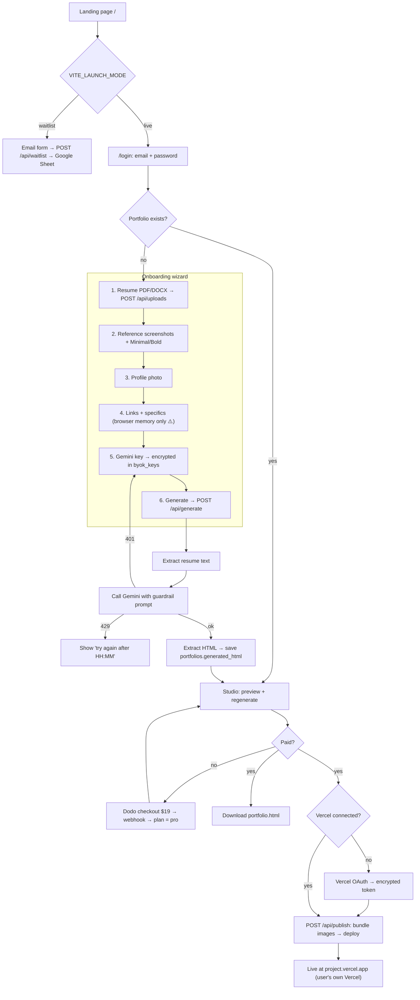
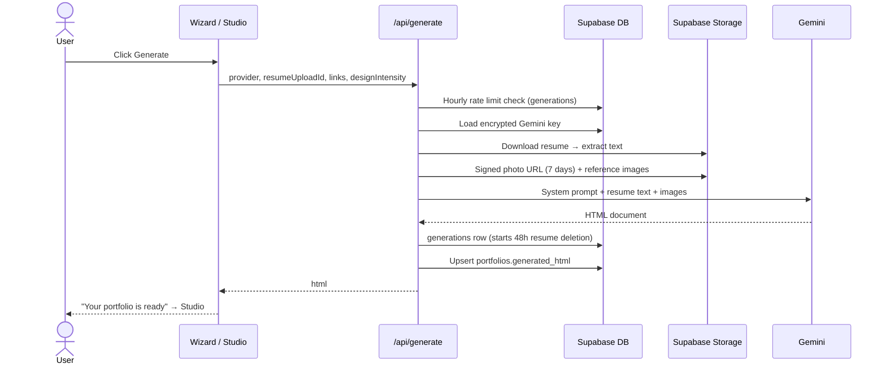
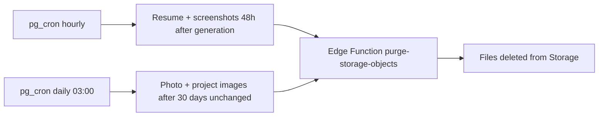
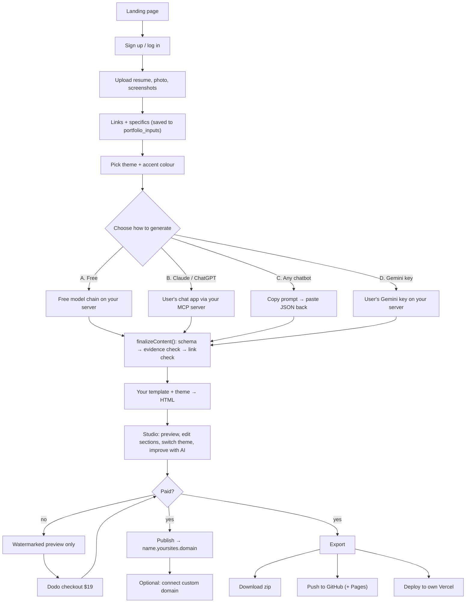
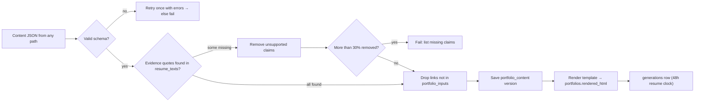
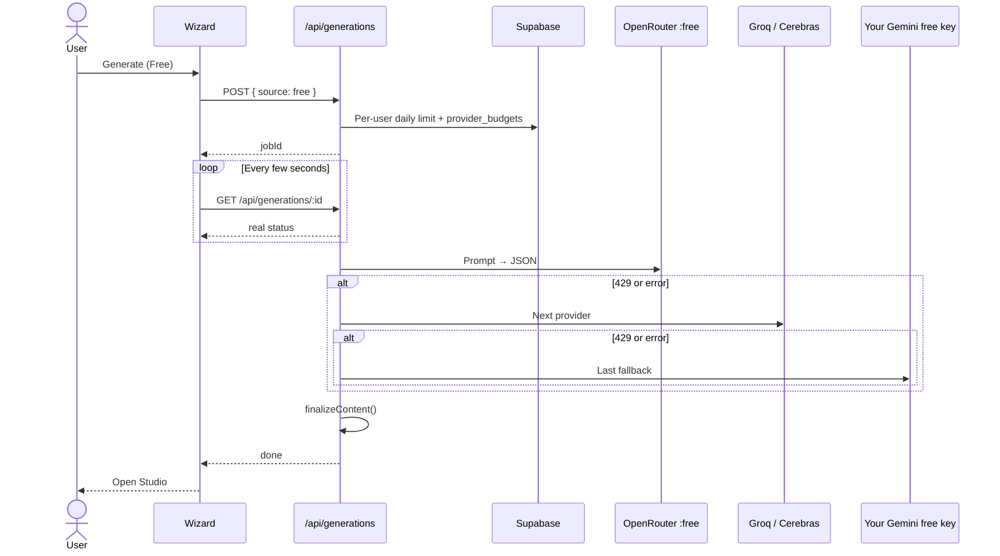
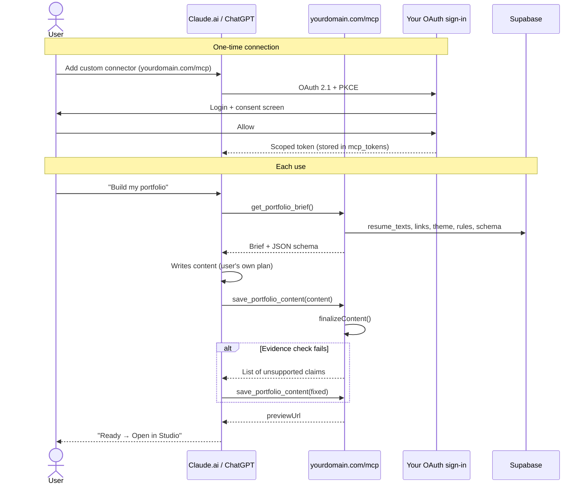
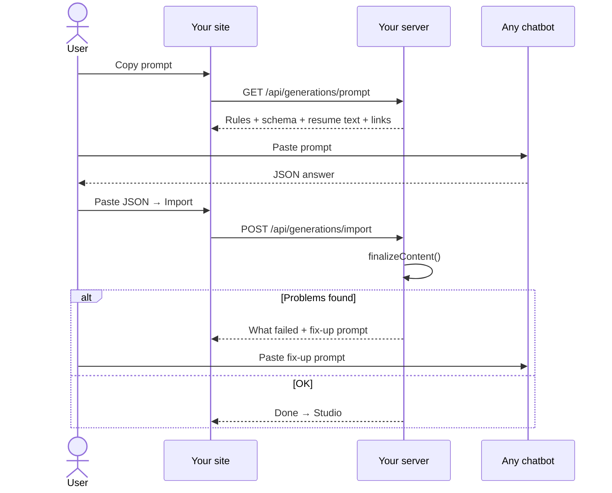
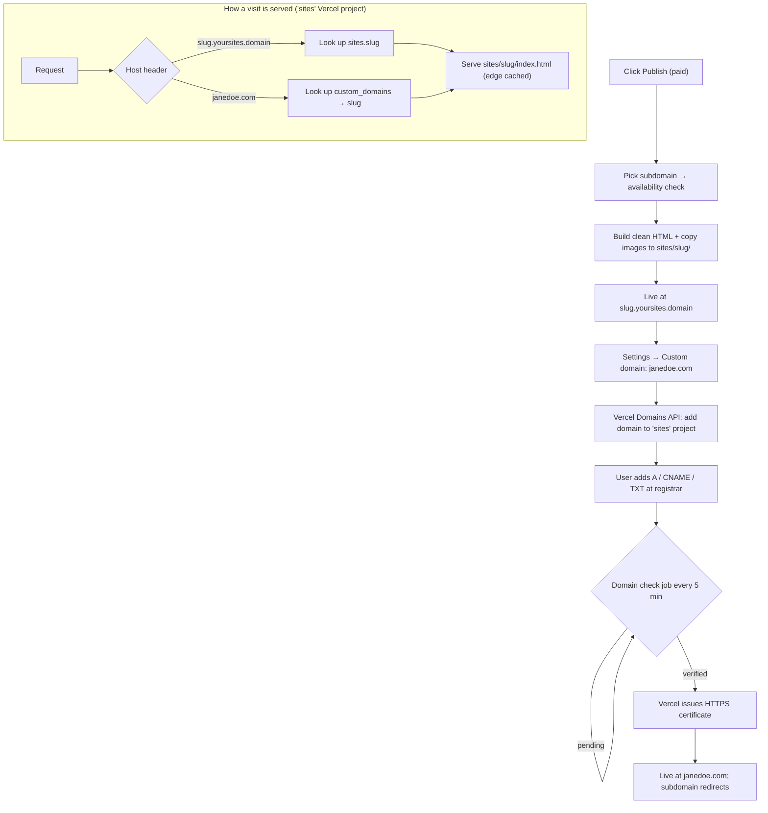
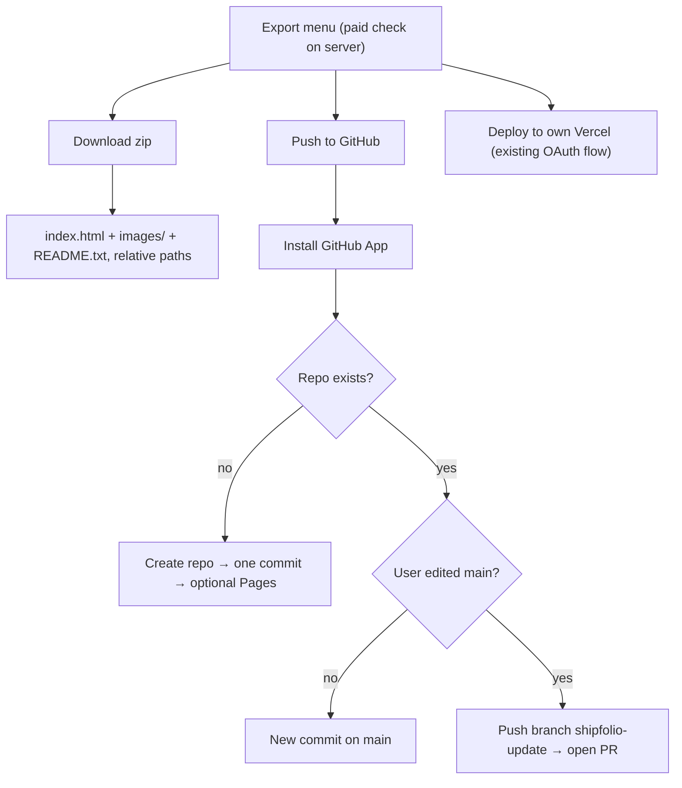

# User Flow: Current and Proposed

Status as of 2026-10-11.

- **Part 1** describes how the product works today, traced through the code.
- **Part 2** describes the proposed product: new AI generation paths, hosting on your own domain, custom domains, and paid export.

---

# Part 1: Current flow (as built)

Publishing today deploys to **the user's own Vercel account**, not to your domain. Download is paid-only: Studio's Download button needs `hasPaidAccess`.

## Diagram: current user journey



## Diagram: generation request in detail



## Diagram: background data retention



## Stage 0: Landing page (`/`)

**User sees:** the marketing page with the cinematic hero video and calls to action.

**Behind the scenes:**
- `getLaunchMode()` reads `VITE_LAUNCH_MODE` when the site is built.
  - **Waitlist mode** (`waitlist`, `false`, `0`, `off`, `no`): every call to action becomes an email form. Submitting it calls `POST /api/waitlist`, which checks the email with zod and forwards it with a shared secret to a **Google Apps Script** that writes a row in a Google Sheet. Nothing is stored in Supabase.
  - **Live mode:** the buttons link to `/login?redirect=/onboarding`.
- Changing this switch needs a redeploy because the value is fixed at build time.

## Stage 1: Sign up or log in (`/login`)

**User sees:** an email and password form.

**Behind the scenes:**
- **Sign up:** `supabase.auth.signUp()` runs in the browser. Supabase sends a confirmation email (from `noreply@mail.app.supabase.io`; the UI warns it may land in spam). The user confirms, then comes back and signs in.
- **Sign in:** `signInWithPassword()` creates a Supabase session cookie.
- **Where they land:** an explicit `redirect` wins. Otherwise the app calls `GET /api/content`: if a portfolio exists they go to `/studio`, if not to `/onboarding`.
- `AuthProvider` also calls `GET /api/me`, which:
  - creates the user's row in `users` if it's missing (`plan = free`)
  - returns `plan`, `isAdmin`, `hasPaidAccess`, storage used and Vercel connection status.

**Security in place:**
- Every `/api/*` route uses `authMiddleware`, which reads the session from the cookie on the server.
- A global check rejects any POST, PUT or DELETE whose `Origin` isn't `APP_ORIGIN` (webhooks are exempt and use signatures instead).
- Users can't upgrade themselves: migration 0006 removes their permission to update `plan` and `is_admin`.

## Stage 2: The 6-step wizard (`/onboarding`)

When the wizard opens, it checks for an existing resume (`GET /api/uploads?kind=resume`) and a saved key (`GET /api/byok-keys`), so returning users skip ahead.

### Step 1: Resume (required)

**User:** uploads a PDF or DOCX (5 MB max).

**`POST /api/uploads` does, in order:**
1. Checks the size, then **checks the real file type from its bytes** (`file-type`). The filename and browser-reported type are ignored.
2. Applies the hourly upload limit: Free 10/hr, Pro 30/hr (counted from the `uploads` table).
3. Checks storage quota: Free 50 MB, Pro 250 MB.
4. Cleans the filename and stores the file at `uploads/{userId}/resume/{uuid}-{name}` in Supabase Storage.
5. Inserts an `uploads` row. If that fails, the stored file is deleted.
6. Resume and photo are **single-slot**: a new upload replaces the old one, which is deleted only after the new one is safely stored.
7. Returns a signed URL valid for 1 hour.

### Step 2: Visual style (optional)

**User:** uploads up to 3 reference screenshots and picks **Minimal** or **Bold**.

**Behind the scenes:** same upload pipeline. Images are also re-encoded with `sharp`, which **removes EXIF and GPS data**. The Minimal/Bold choice stays in the browser only.

### Step 3: Profile photo (optional)

Same pipeline as step 2, single-slot, metadata removed.

### Step 4: Links and specifics

**User:** adds LinkedIn, GitHub, GitHub project links, other links, and free text ("target role, tone…").

**Behind the scenes:** nothing is saved. ⚠️ All of this lives in browser memory only. Refreshing the page loses it.

### Step 5: Gemini key

**User:** follows the link to `aistudio.google.com/app/apikey`, creates a free key and pastes it in.

**`POST /api/byok-keys`:**
- Only `google` is allowed (`BYOK_ENABLED_PROVIDERS`). The Anthropic and OpenAI code exists but is switched off.
- The key is encrypted with **AES-256-GCM** using `ENCRYPTION_KEY` from the environment, and only the encrypted value and nonce are stored in `byok_keys`. A database leak alone can't reveal keys.
- The key **isn't tested when saved**. It's only checked the first time it's used to generate.
- `GET /api/byok-keys` never returns the key itself.

### Step 6: Generate

**User:** reviews a summary and clicks Generate. The orb animation plays with progress messages. ⚠️ These messages run on timers (1.5 s, 4.5 s, 12 s); they don't reflect real progress.

**`POST /api/generate`, step by step:**
1. **Validate the input:** provider must be `google`, `resumeUploadId` is required, design is `minimal` or `bold`, links are cleaned (300 characters and 10 items max).
2. **Rate limit:** Free 5/hr, Pro 20/hr, counting rows in `generations`. Failed attempts count too.
3. **Load the key:** none saved → `401 byok_key_missing`, and the UI jumps to step 5.
4. **Load the resume** from Storage and extract plain text (`pdf-parse` or `mammoth`). The model receives text, never the original file.
5. **Load design inputs:**
   - Photo → a **signed URL valid for 7 days**, which gets written into the HTML.
   - Up to 3 reference screenshots → downloaded and sent as base64 images.
6. **Decrypt the key**, used in memory only.
7. **Build the prompt:**
   - **System prompt** (`GUARDRAIL_SYSTEM_PROMPT`): the resume is the only source of facts; never invent skills, metrics or employers; leave out empty sections; check every claim; output one complete HTML file with inline CSS, responsive, accessible, with anchor navigation.
   - **User message:** resume text, specifics, the photo URL or "no photo, use a typographic hero", the verified links ("use these exact URLs, invent none"), the Minimal or Bold direction, and copywriting rules (action verbs, X-Y-Z bullet format, 3–5 skill groups).
8. **Call Gemini** (`gemini-3.5-flash`), with images placed before the text.
   - 401/403 → `byok_key_invalid`, and the UI jumps to step 5.
   - 429 → the retry time is read from the response, and the UI shows "try again after HH:MM".
   - Other errors → 502.
   - Any failure records a `failed` row in `generations`.
9. **Record success** with a `succeeded` row in `generations`. ⚠️ This starts the **48-hour deletion clock** on the resume and screenshots (see Stage 6).
10. **Extract the HTML:** strip markdown code fences and commentary, cut from `<!doctype` or `<html>` to `</html>`, and reject anything under 200 characters (422). ⚠️ There's no sanitising; any `<script>` the model writes is kept.
11. **Save:** upsert `portfolios.generated_html`. There's **one portfolio per user**, keyed by `user_id`, so generating again overwrites the previous one.
12. The UI refreshes the "portfolio ready" check, shows a "Your portfolio is ready" screen, and the user clicks through to Studio.

## Stage 3: Studio (`/studio`)

**Access:** only if a portfolio exists (or the user is an admin). Otherwise they're sent back to `/onboarding`.

**User sees:**
- **Live preview** in desktop, tablet and mobile sizes. It's an `<iframe srcDoc>` with `sandbox="allow-same-origin"`, so ⚠️ **scripts don't run in the preview**, and anything JavaScript-driven will look different once deployed.
- **Regenerate with instructions:** a text box and a confirmation dialog.
- **Download HTML** and **Publish** buttons.

**Regenerate** calls the same `POST /api/generate`, but sends only `provider`, `resumeUploadId` and the new instructions. ⚠️ This means:
- **Links are lost.** They aren't saved anywhere, so the new site has no LinkedIn or GitHub links.
- **The design style resets to Minimal**, even if the user chose Bold.
- **After 48 hours the resume is gone**, so regenerating fails with "No resume on file".

**Download:**
- Paid users get a `portfolio.html` file built in the browser.
- Free users are sent to checkout instead.
- ⚠️ The photo inside is the 7-day signed URL, so the **downloaded file's photo stops loading after 7 days**.
- ⚠️ The paywall is only in the UI. `GET /api/content` returns the full HTML to any logged-in user, so a free user can copy it from the browser's developer tools.

## Stage 4: Payment

**User:** clicks Upgrade (in Settings) or "Unlock" (in Studio).

**Behind the scenes:**
1. `POST /api/billing/checkout` creates a **Dodo Payments** checkout for the Pro product. The `userId` is attached to the payment, and the user is sent to Dodo's checkout page.
   - In test mode it goes to `/api/dev/payment-test` instead.
2. The user pays **$19 once**. There's no subscription and nothing recurring.
3. Dodo sends the user back to `/settings?upgrade=pending` or `/studio?upgrade=pending`.
4. Separately, Dodo calls `POST /api/webhooks/dodo`:
   - The signature is checked with an HMAC (Standard Webhooks).
   - Only `payment.succeeded` is handled.
   - `grantProAccess` inserts a row in `purchases` (the payment ID is unique, so a repeated webhook does nothing) and sets `users.plan = 'pro'` using the admin client.
5. Because the webhook can arrive a moment after the redirect, Settings re-checks the plan.

**Switches:**
- `PAYMENTS_ENABLED=false` → `hasPaidAccess()` is true for everyone, so everything is free.
- Admins (`is_admin`, set from `/admin`) always have access.

## Stage 5: Publish (to the user's own Vercel)

**User:** clicks Publish in Studio.

### 5a. Connect Vercel (first time only)

1. `GET /api/vercel/oauth/start` checks for paid access (if missing, back to Studio with `payment_required`), then creates a signed `state` value tied to the user and sends them to Vercel's sign-in.
2. The user approves on Vercel.
3. `GET /api/vercel/oauth/callback` checks the `state`, exchanges the code for an access token and team ID, looks up the Vercel username, then **encrypts the token with AES-GCM** and saves it in `vercel_connections`.
4. The user is sent back to `/studio?vercel=connected`.

### 5b. Deploy

`POST /api/publish`:
1. Vercel not connected → 409.
2. Not paid → **402**. This is the real server-side paywall.
3. Load `generated_html`.
4. **Bundle the images** (`embedStorageImagesInHtml`): find every signed URL from your storage in the HTML, download each image, and replace the URL with `images/<file>`. The live site doesn't depend on your storage or on the URLs expiring.
5. Decrypt the Vercel token.
6. Name the project from the page's `<title>` (made URL-safe, 50 characters max), falling back to the email.
7. Upload each file to Vercel by its hash, then create a **production** deployment with no framework.
8. Insert a `publications` row with status `queued`, and mark the bundled uploads as `published = true`.
9. Return 202.

### 5c. Status

The UI polls `GET /api/publish/status`. The server asks Vercel for the deployment state (Queued, Building, Ready or Error), updates the `publications` row, and stops checking once it's finished.

**Result:** the site is live at `<project>.vercel.app` **in the user's own Vercel account**. To change it later, they regenerate and publish again.

## Stage 6: Data retention (automatic, in the background)

Scheduled database jobs (`pg_cron`) remove data automatically. SQL can't delete Storage files directly, so the jobs call the `purge-storage-objects` Edge Function (through `pg_net`, authenticated with a shared `CRON_SECRET`) to delete the actual files.

| Job | When | What it deletes |
|---|---|---|
| `purge-post-generation-uploads` | Every hour | **Resume and reference screenshots** 48 h after a successful generation |
| `purge-stale-draft-uploads` | Daily at 03:00 | **Photo and project images** when the portfolio hasn't changed for 30 days |
| `queue-stale-draft-warnings` | Daily at 04:00 | Nothing; it queues warnings for days 27–28 |
| Orphan purge (migration 0008) | Scheduled | Storage files with no matching database row |

**Settings → Reset** (`POST /api/reset`) deletes all uploads and clears the portfolio. It keeps the Gemini key, the Vercel connection, payment history and published sites.

## Problems found in the current flow

| # | Issue | What the user experiences |
|---|---|---|
| 1 | Links and specifics are never saved | Refreshing the wizard loses them; regenerating in Studio removes all links |
| 2 | Studio regenerate doesn't send `designIntensity` | A Bold site becomes Minimal when regenerated |
| 3 | Resume is deleted 48 h after generating | Regenerating in Studio stops working after 2 days |
| 4 | Download contains the 7-day photo URL | The downloaded site's photo breaks after a week (publishing is fine because it bundles images) |
| 5 | Download paywall is only in the UI | Free users can get the HTML from `/api/content` in developer tools |
| 6 | Preview blocks scripts | The preview can look different from the deployed site |
| 7 | No HTML sanitising | Whatever scripts the model writes go live (only on the user's own Vercel today, but it matters once you host on your domain) |
| 8 | Progress messages are on timers | Not real progress; minor |
| 9 | Error text mentions "Schema Validation" for a 422 | Left over from the earlier JSON design; minor |

---

# Part 2: Proposed flow

Markers: **🆕 New**, **🔁 Changed**, **✅ Kept**. The proposed flow also fixes the 9 problems listed in Part 1.

## The core idea: one pipeline, four ways in

```
                ┌─ A. Free models (your server)
                ├─ B. Their Claude / ChatGPT (MCP)      ─┐
Resume + inputs ┼─ C. Any chatbot (copy-paste)           ├─▶ Portfolio content (JSON)
                └─ D. Their Gemini key (your server)    ─┘          │
                                                                    ▼
                                         Check it → your template + theme → HTML
                                                                    │
                          Studio preview ◀──────────────────────────┤
                          Publish → name.yoursites.domain / custom domain
                          Export (paid) → zip / GitHub
```

**🔁 Changed: the model no longer writes HTML.** Every path produces the same **portfolio content JSON**, and your server builds the HTML from your templates. Every path then gets:
- Consistent design quality whichever model was used
- Safe output: no model-written scripts, all text escaped (fixes #7)
- A preview identical to the live site (fixes #6)
- A content check that works even with models you don't control (MCP, copy-paste)

### The content JSON (the contract every path must meet)

```jsonc
{
  "profile":   { "name", "headline", "summary", "location" },
  "links":     [{ "label", "url" }],          // only URLs the user gave
  "experience":[{ "role", "company", "start", "end",
                  "bullets": [{ "text", "evidence" }] }],
  "projects":  [{ "name", "summary", "tech": [], "bullets": [...], "url" }],
  "skills":    [{ "group", "items": [{ "name", "evidence" }] }],
  "education", "certifications"               // left out if not on the resume
}
```

**🆕 `evidence`** is the key addition. Every bullet and skill must include a short quote copied from the resume. Your server checks that each quote really appears in the resume text (allowing for small wording differences). Claims without real evidence are removed or rejected. That turns your rule "the resume is the only source of facts" from a request to the model into something the server enforces.

## Diagram: proposed user journey



## Diagram: the shared pipeline (finalizeContent)



## Diagram: path A (free models)



## Diagram: path B (Claude or ChatGPT via MCP)



## Diagram: path C (copy-paste)



## Diagram: publish, custom domain and serving



## Diagram: export (paid)




Same as today (waitlist or live mode, Supabase email and password, `/api/me`, the cross-site request check). One addition:

- **🆕** `/api/me` also returns `generationOptions` (which paths are available to this user right now, for example "free capacity left today: 2") and `site` (their subdomain and custom domain, if any).

## Stage 2: The wizard (`/onboarding`)

### Steps 1–3: Resume, visual style, photo: ✅ Kept, plus 🆕 saved resume text

Same upload pipeline. One addition:

- **🆕** On resume upload, the server extracts the text once and saves it in a new `resume_texts` table, deleted together with the resume under the same 48-hour rule. Every path (including MCP and copy-paste, which never see your server's model) can use it, and the evidence check compares against it.

### Step 4: Links and specifics: 🔁 now saved (fixes #1)

**User:** same form as today.

**Behind the scenes:** each change is saved (with a short delay) through a new `PUT /api/portfolio/inputs` into a 🆕 `portfolio_inputs` table: `links`, `specifics`, `design_intensity`, `theme`. Refreshing the page loses nothing, and every generation path and every regeneration reads from here (fixes #2).

### Step 5: 🔁 "Choose how to generate" (replaces "Connect Gemini key")

**User sees four cards:**

| Card | Label | Shown as |
|---|---|---|
| A | ⚡ **Free**: no setup | "2 of 3 free generations left today" |
| B | 🤖 **Use my Claude or ChatGPT** | "Best quality, uses your plan" |
| C | 📋 **Use any chatbot** | "Copy a prompt, paste back the result" |
| D | 🔑 **My Gemini key** | "Free key from Google, 2 minutes to set up" |

**Behind the scenes:** the choice is saved in `portfolio_inputs.preferred_source`. Each path continues below.

### Step 6: Theme 🆕

**User:** picks one of your templates (for example Editorial, Studio, Terminal, Minimal Mono) and an accent colour. They can change it later in Studio **with no AI call**.

**Behind the scenes:** templates live in your codebase, so this is a database field (`theme`), not a model decision. The reference screenshots from step 2 are only used to suggest a theme and colours.

## Stage 3: Generate (four paths)

### Shared: generation jobs 🆕

Generation becomes a **background job**, not one long request. Free models are slower, and Vercel functions have time limits.

- `POST /api/generations` with `{ source }` → inserts a 🆕 `generation_jobs` row (`queued`), returns `jobId` straight away.
- The UI checks `GET /api/generations/:id` every few seconds. The status is **real**: `extracting` → `writing` → `checking` → `rendering` → `done` or `failed` (fixes #8).
- When the job finishes successfully, it always does the same thing, called `finalizeContent()`:
  1. **Check the JSON shape** (zod) → if wrong, retry once with the errors sent back to the model, then fail
  2. **Evidence check** against `resume_texts` → remove unsupported bullets and skills; fail if more than 30% were removed
  3. **Link check** → drop any URL not in `portfolio_inputs.links`
  4. Save to 🆕 `portfolio_content` (keeps a version history: `version`, `source`, `model`)
  5. Build the HTML from template + theme + content → save to `portfolios.rendered_html`
  6. Record a `generations` row (this starts the 48-hour resume deletion, ✅ kept)

### Path A: Free models 🆕

**User:** clicks **Generate**, watches real progress, and lands in Studio about 30–90 s later.

**Behind the scenes:**
1. **Per-user daily limit:** for example Free plan 3/day, Pro 10/day (🆕 `checkDailyRateLimit`, same approach as the existing hourly one).
2. **Shared daily budget:** a 🆕 `provider_budgets` table holds one counter per provider per day. If every provider is used up, the request is refused with `free_capacity_exhausted`, and the UI suggests paths B, C or D.
3. **Fallback chain** (set in `config/llm.ts` → 🆕 `FREE_PROVIDER_CHAIN`):
   ```
   OpenRouter :free model #1 → OpenRouter :free model #2 → Groq → Cerebras → your Gemini free key
   ```
   - One 🆕 `callOpenAICompatible()` adapter covers OpenRouter, Groq and Cerebras (they share the same request format). Your keys live in environment variables.
   - Each call asks for **JSON output**, using the provider's structured or JSON mode where it exists.
   - 429 or 5xx → mark that provider "cooling down" for the time it gives → try the next one. A provider is never retried in a loop.
   - Invalid JSON → one repair attempt on the same provider → then the next provider.
4. On success → `finalizeContent()`.
5. **Prompt:** your existing guardrail rules, rewritten to require JSON + evidence instead of HTML. Reference images are sent only to models that accept images; otherwise they're skipped (the theme already reflects the user's taste).

**Privacy note in the UI:** "Free AI providers may keep prompts to improve their models. Use path B, C or D if you'd rather they didn't."

**Cost to you:** nothing. Monthly cost is optional: a small one-time OpenRouter credit raises its free daily limit.

### Path B: Their Claude or ChatGPT via MCP 🆕

#### One-time connection (about 2 minutes)

**User:**
1. Clicks **Use my Claude or ChatGPT** → opens 🆕 `/connect`, which has:
   - The connector URL: `https://yourdomain.com/mcp` with a copy button
   - Step-by-step tabs: **Claude.ai** (Settings → Connectors → Add custom connector) and **ChatGPT** (Settings → Connectors / Apps → add)
2. Pastes the URL into Claude or ChatGPT.
3. The chat app opens **your login page** in a popup → they sign in with their usual email and password → a consent screen: "Claude wants to read your resume and save your portfolio. [Allow]".
4. The popup closes. The connector shows as connected.

**Behind the scenes:**
- Your app acts as an **OAuth 2.1 sign-in server** for MCP (dynamic client registration and PKCE, which is what Claude and ChatGPT expect). Use Supabase Auth's OAuth server feature if it fits your setup, or a small sign-in server inside your app, built on your existing Supabase login.
- Tokens are scoped to `portfolio:read portfolio:write`, short-lived, and refreshable. They're stored in 🆕 `mcp_tokens` and revocable from Settings ("Connected apps").
- 🆕 The `/mcp` route is added to your TanStack Start app and uses the official MCP TypeScript SDK over Streamable HTTP.

#### Each use

**User, in Claude or ChatGPT:** "Build my portfolio." (Optionally: "focus on backend roles, keep it punchy.")

**Behind the scenes, as the model calls your tools:**

| # | Tool call | What your server does |
|---|---|---|
| 1 | `get_portfolio_brief()` | Checks the token → returns resume text, saved links, specifics, theme, the content rules (your guardrails) and the **JSON schema**. Reference images are returned as image content. If the resume was already deleted (48 h) → "Upload your resume at yourdomain.com/onboarding first." |
| 2 | *(model writes content in the chat; this uses **their** plan's capacity)* | Nothing; you pay nothing |
| 3 | `save_portfolio_content(content)` | Rate limit → `finalizeContent()`. **If the evidence check fails**, the reply lists exactly which claims weren't found in the resume, and the model fixes them and calls again. On success it returns `{ previewUrl: "https://yourdomain.com/studio" }` |
| 4 | *(model shows the link)* | "✅ Your portfolio is ready → **Open in Studio**" |

**Follow-up tools** let them keep editing in chat:
- `update_section(section, content)`: for example "make my summary shorter" → only that section is checked and saved
- `list_themes()` / `set_theme(id)`: "try a darker theme"
- `get_portfolio_content()`: so the model can see the current version before editing

**Your rules are enforced in three places:**
1. Server instructions (sent when connecting) and tool descriptions → guidance
2. The input schema → the model must match the shape
3. `finalizeContent()` → evidence and link checks. **This is the real guarantee.**

**The model never sees or sends HTML**, so even in this path the user can't take the site without paying.

### Path C: Any chatbot (copy-paste) 🆕

**User:**
1. Clicks **Copy prompt**. One click copies a prompt containing: your rules + the JSON schema + their resume text + links + specifics.
2. Pastes it into any chatbot (free ChatGPT, Claude, Gemini, DeepSeek…).
3. Copies the JSON answer, pastes it into the box on your site, and clicks **Import**.
4. If something is wrong, the page shows exactly what failed ("3 claims not found in your resume: …") plus a **Copy fix-up prompt** button to send back to the same chatbot.

**Behind the scenes:**
- `GET /api/generations/prompt` builds the prompt from `resume_texts` + `portfolio_inputs`.
- `POST /api/generations/import` → removes any ```` ```json ```` fences → `finalizeContent()` → same result as every other path.
- It counts against the per-user rate limit (because building the site costs you a little server time).

### Path D: Their Gemini key: ✅ Kept, 🔁 now returns JSON

Same key storage (AES-GCM) and same error handling (`byok_key_invalid` → back to key setup; 429 → "try after HH:MM"). Two changes:
- 🔁 It asks Gemini for JSON (`responseMimeType: application/json` + the schema) instead of HTML → `finalizeContent()`.
- 🆕 The key is **tested when saved** (one tiny request), so an invalid key shows up immediately, not at generation time.

## Stage 4: Studio (`/studio`)

**User sees:**
- **Preview:** desktop, tablet and mobile sizes. It's the **exact HTML your template builds**, so preview = live site (fixes #6). Free users see a "Preview, not published" banner built into the page.
- 🆕 **Edit panel** with a tab per section (Profile, Experience, Projects, Skills, Links). The user edits text directly, reorders and hides items. **No AI needed, and it's free.** Changes save to a new `portfolio_content` version and the preview updates straight away.
- 🆕 **Theme switcher:** change template or colour instantly, no AI call.
- 🔁 **Improve with AI:** "make it punchier", "focus on leadership". It runs through the same path as the original generation (free models, Gemini key, or "do this in Claude", which shows the instruction to paste). It sends the **current content + saved inputs**, so **links and style are kept** (fixes #1 and #2).
- 🆕 **Version history:** "Restore version 3".
- Publish, Download and GitHub buttons. For free users they lead to Upgrade.

**Behind the scenes:**
- `GET /api/content` 🔁 returns `{ content, renderedHtml, theme, version }`.
- **Regenerating after 48 hours** (fixes #3): the content already exists, so **editing and "improve with AI" keep working**. Only a **full regenerate from the resume** needs the resume, and the UI says so: "Your resume was deleted for privacy after 48 hours. Upload it again to regenerate from scratch."
- **Free users** get the HTML with the watermark built in. The clean HTML is only built for paid publish and export (fixes #5: the paywall is now on the server, not just the UI).

## Stage 5: Payment: ✅ Kept

Same Dodo Payments flow: checkout → webhook (signature checked, duplicates ignored) → `plan = 'pro'`. `PAYMENTS_ENABLED` and the admin exemption are unchanged.

**One decision for you:** you'll now host paid sites indefinitely for a **one-time $19**. Static sites are cheap to host, so this is workable, but decide how you want to handle it:
- Keep it **one-time** (simplest; hosting cost per site is close to zero), or
- **One-time + an optional yearly add-on** for custom domains. Custom domains are the only part with per-domain cost if you ever move to Cloudflare for SaaS.

## Stage 6: Publish to your domain 🆕 (replaces the user's own Vercel as the default)

### 6a. Choose a subdomain (first publish)

**User:** clicks **Publish** → picks a name: `jane` → sees `jane.yoursites.domain`, with live "✓ available" or "✗ taken" checking → **Publish**.

**Behind the scenes:**
- `GET /api/sites/check?slug=jane` checks: lowercase letters, numbers and hyphens only, 3–40 characters, not reserved (`www`, `api`, `admin`, `app`, `mail`…), not taken, no offensive words.
- Saved in 🆕 `sites` (`user_id`, `slug` unique, `status`, `published_version`).

### 6b. Publish

`POST /api/publish` 🔁:
1. **Paid check** → 402 if not paid (✅ kept).
2. Load the latest `portfolio_content` → build **clean** HTML (no watermark).
3. **Bundle images:** copy the photo and project images into 🆕 a **`sites` storage area** (`sites/{slug}/images/…`, readable publicly) and replace every signed URL with a relative path. This is the same idea as today's `embedStorageImagesInHtml`, aimed at your storage instead of the user's Vercel. **The published files don't depend on uploads**, so the 30-day upload clean-up can never break a live site.
4. Write `sites/{slug}/index.html`.
5. Update `sites.published_version`, `status = live`, `published_at`.
6. Clear the cache for that hostname.
7. Return `{ url: "https://jane.yoursites.domain" }`. It's live in seconds; there's no build step or status polling (the `publications` table can stay as history).

### 6c. How the site is served

- A **separate Vercel project** (`sites`) on a **separate domain** (`yoursites.domain`), so your app's login cookies are never exposed to user pages.
- Its middleware reads the `Host` header and looks up the matching site:
  - `jane.yoursites.domain` → `slug = jane`
  - `janedoe.com` → look up `custom_domains` → `slug`
- It serves `sites/{slug}/index.html` with long caching at Vercel's edge, cleared on republish.
- Unpublished or missing → a friendly "This portfolio isn't published" page.
- Free preview pages are marked `noindex`; published sites are indexable and include a sitemap and OpenGraph tags (generated from the content: name, headline, photo).

### 6d. Updating

**User:** edits in Studio → clicks **Update site** → steps 2–6 run again. The live site changes in seconds and the subdomain stays the same.

### ✅ Kept, as an option: "Deploy to my own Vercel"

The existing Vercel OAuth flow moves into the **Export** menu for people who want the site in their own account.

## Stage 7: Custom domain 🆕 (paid)

**User:**
1. Settings → **Custom domain** → types `janedoe.com` → **Connect**.
2. Sees a DNS record table with copy buttons, plus short guides for GoDaddy, Namecheap, Cloudflare, Google/Squarespace and Hostinger:

   | Type | Name | Value |
   |---|---|---|
   | A | `@` | *(Vercel IP, taken from the API response)* |
   | CNAME | `www` | *(Vercel CNAME target, from the API response)* |
   | TXT | `_vercel` | *(only if Vercel asks for ownership proof)* |

3. Status: **"Waiting for DNS…"** → automatically **"Securing with HTTPS…"** → **"Live ✅"**. Usually minutes, sometimes hours.
4. They choose the main address (`janedoe.com` or `www.janedoe.com`); the other redirects to it.

**Behind the scenes:**
1. `POST /api/domains` → paid check → check the domain format → refuse your own domains → one custom domain per site.
2. Call the **Vercel Domains API** to add the domain to the `sites` project → save the required DNS records and verification details in 🆕 `custom_domains` (`hostname`, `status: pending`).
3. 🆕 A scheduled job every 5 minutes (plus a **Verify now** button → `POST /api/domains/:id/verify`) asks Vercel for the domain's status → updates `pending` → `verified` → `live`. Vercel issues the HTTPS certificate automatically.
4. Once live: the subdomain **redirects** to the custom domain, so old links still work.
5. **Remove** → delete it from Vercel → the subdomain is the main address again.
6. A domain still pending after 7 days → email the user, and remove it after 14 days.

**Before building:** check Vercel's limit on domains per project for your plan. If you expect thousands, Cloudflare for SaaS is the alternative.

## Stage 8: Export 🆕 (paid: "a paid user should have everything")

### 8a. Download zip

**User:** clicks **Download** → gets `jane-portfolio.zip`:

```
index.html
images/photo.jpg
images/project-1.png
README.txt   ← "Open index.html, or upload this folder to any static host"
```

**Behind the scenes:** `GET /api/export/zip` → **paid check on the server** (fixes #5) → build clean HTML → bundle the images with relative paths (fixes #4: the photo never expires) → zip it on the fly → send the download. Every export is logged in 🆕 `exports`.

### 8b. Push to GitHub

**User:**
1. **Export → GitHub** → "Connect GitHub" → approves your GitHub App (access only to repositories it creates or that they choose).
2. Picks a repository name (`jane-portfolio`), public or private, and ticks **Turn on GitHub Pages**.
3. **Push** → "✅ Pushed to github.com/jane/jane-portfolio" plus the Pages URL if enabled.
4. Later, after Studio edits: **Push update**.

**Behind the scenes:**
- A **GitHub App** (more limited access than an OAuth App). The installation ID is stored in 🆕 `github_connections`; tokens are short-lived and created when needed, so nothing long-lived is stored.
- First push: create the repository → upload the same files as the zip in one commit through GitHub's Git Data API (blobs → tree → commit → update ref) → optionally turn on Pages using the API.
- **Push update:** if the repository's `main` branch has only your commits, add a new commit. **If the user has edited the repository themselves**, push to a `shipfolio-update` branch and **open a pull request** instead of overwriting their work.
- After exporting, the user owns the code. They can change it however they like, and your hosted copy (if published) stays independent.

### 8c. Deploy to my own Vercel: ✅ Kept

The existing OAuth and deploy flow, now using the template-built HTML.

## Stage 9: Data retention 🔁 updated

| Data | Rule | Change |
|---|---|---|
| Resume file + `resume_texts` | Deleted **48 h** after a successful generation | 🔁 extracted text added, deleted on the same schedule |
| Reference screenshots | 48 h after generation | ✅ same |
| Photo and project images (uploads) | 30 days without changes | ✅ same. Published copies are in `sites/` and **aren't** deleted |
| `portfolio_content` versions | Keep the last 20 | 🆕 |
| Published site files (`sites/`) | Kept while published; deleted 30 days after unpublishing or account deletion | 🆕 |
| `mcp_tokens` | Expire automatically; revocable in Settings | 🆕 |
| Generation jobs | Delete after 30 days | 🆕 |

**Reset** 🔁 also clears `portfolio_content`, `portfolio_inputs` and `resume_texts`. It asks separately whether to **unpublish the live site**.

## End-to-end journeys

**Free user (path A):**
Land → sign up → upload resume and photo → add links → pick ⚡ Free → pick a theme → generate (about 60 s) → Studio with watermark → edit text and theme for free → *Publish* → upgrade prompt.

**Claude or ChatGPT user (path B):**
Sign up → upload resume and links → `/connect` → add the connector in Claude → "Build my portfolio" → Claude reads the brief, writes the content, saves it → "Open in Studio" → refine in chat ("shorter summary") or in Studio → pay → publish.

**Paid user, everything:**
Pay $19 → publish at `jane.yoursites.domain` → connect `janedoe.com` (DNS → live) → download the zip → push to GitHub with Pages → keep editing in Studio or chat → **Update site** or **Push update** whenever they like.

## What changes in the system

| | |
|---|---|
| **New tables** | `resume_texts`, `portfolio_inputs`, `portfolio_content`, `generation_jobs`, `provider_budgets`, `sites`, `custom_domains`, `mcp_tokens`, `github_connections`, `exports` |
| **Changed tables** | `portfolios` (`rendered_html` replaces `generated_html`), `generations` (+ `source`, `model`) |
| **New routes** | `/mcp`, `/connect`, OAuth `/authorize` `/token` `/register`, `/api/generations/*`, `/api/portfolio/inputs`, `/api/sites/*`, `/api/domains/*`, `/api/export/zip`, `/api/export/github` |
| **New infrastructure** | A second Vercel project + domain for user sites, a public `sites` storage area, a GitHub App, OpenRouter / Groq / Cerebras keys, a domain-check job |
| **Kept** | Login, upload pipeline, encryption, Dodo payments, `hasPaidAccess`, rate limits, retention jobs, Vercel OAuth (now optional) |

## Recommended build order

1. Structured content + templates + `finalizeContent()`
2. Studio editing
3. Free-model chain
4. Publish to subdomain
5. Zip export
6. Custom domains
7. Copy-paste mode
8. MCP server
9. GitHub push

## To check before building

- Current Claude.ai and ChatGPT plan limits for custom MCP connectors
- Whether Supabase Auth's OAuth server feature fits the MCP sign-in flow
- Current free-tier limits for OpenRouter, Groq and Cerebras
- Vercel's limit on domains per project for your plan
