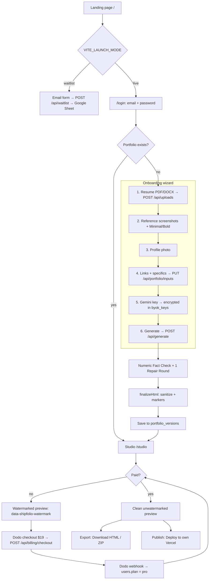
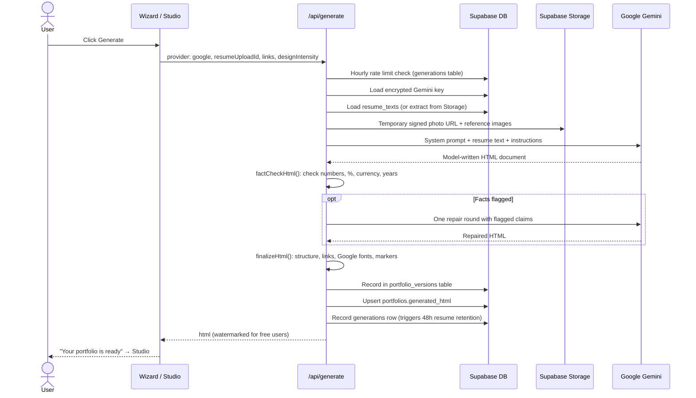
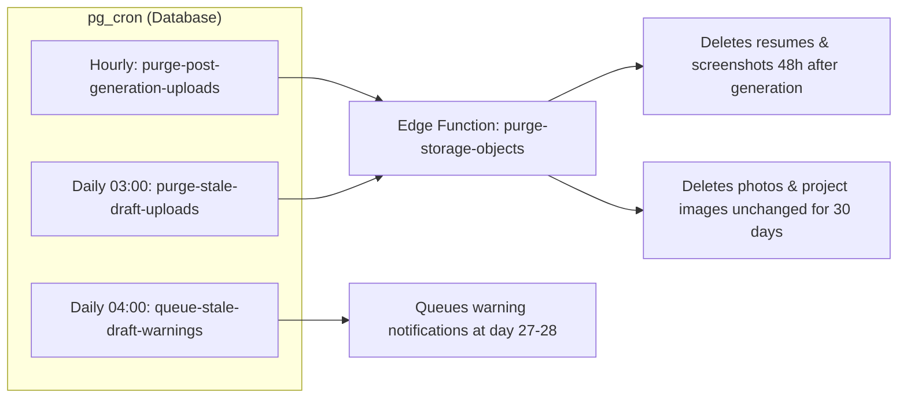
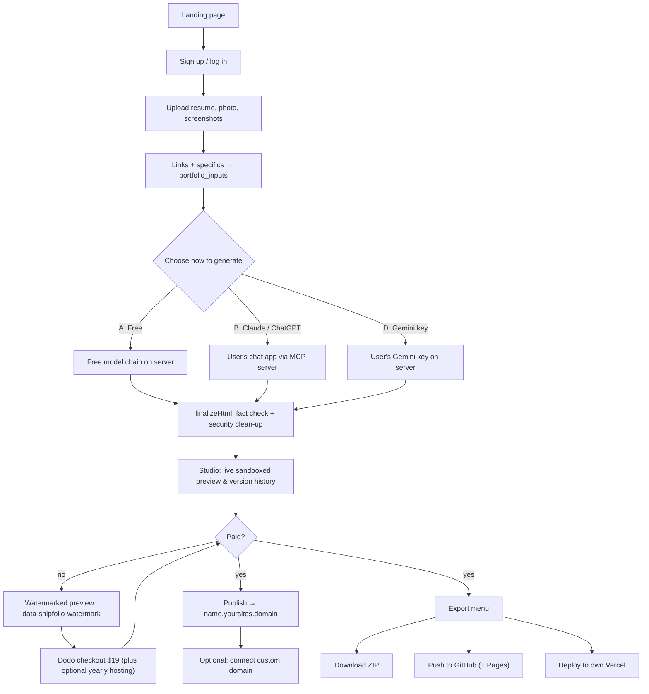
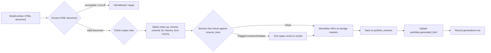
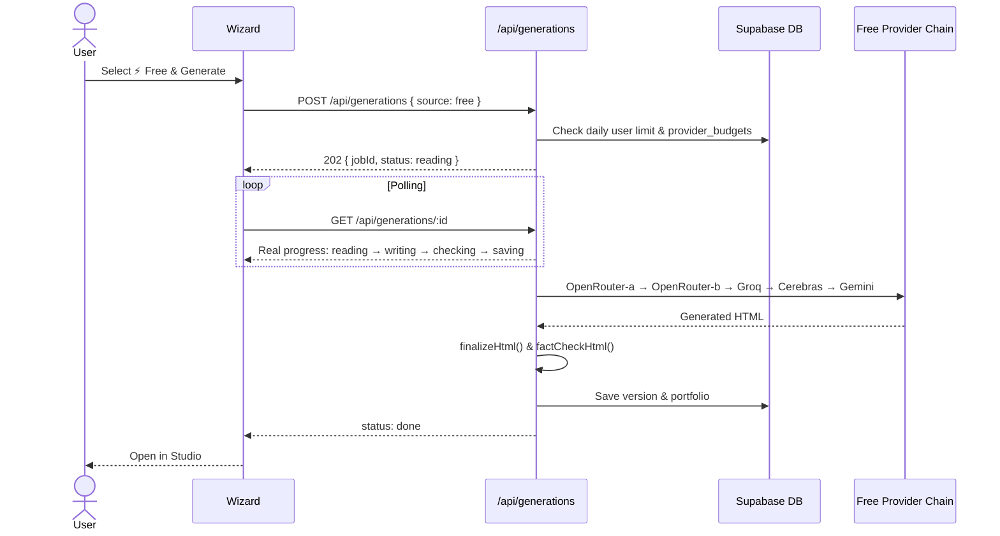
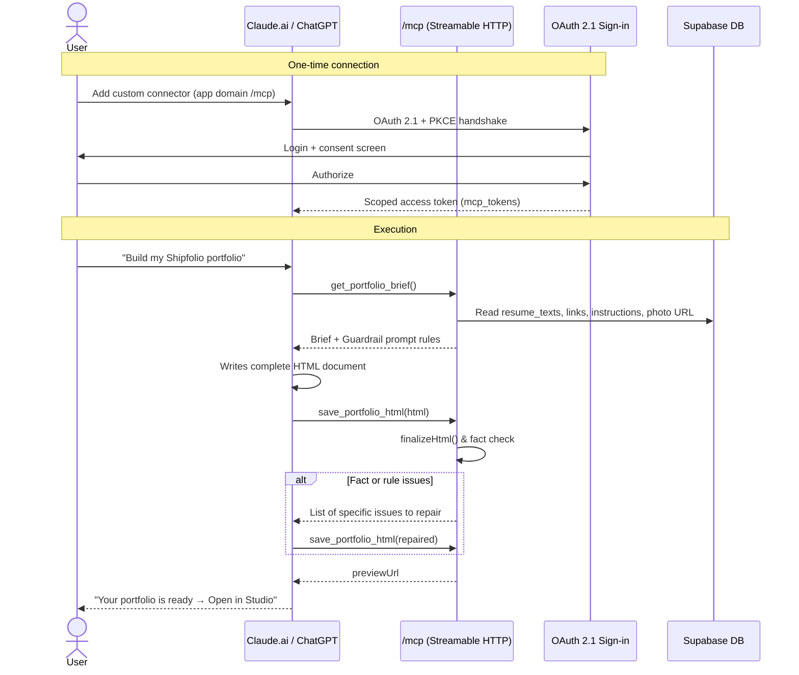
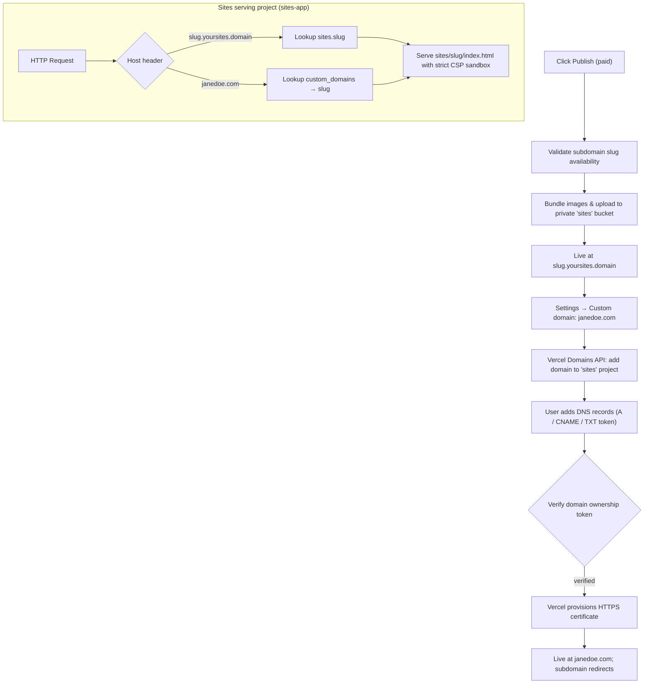
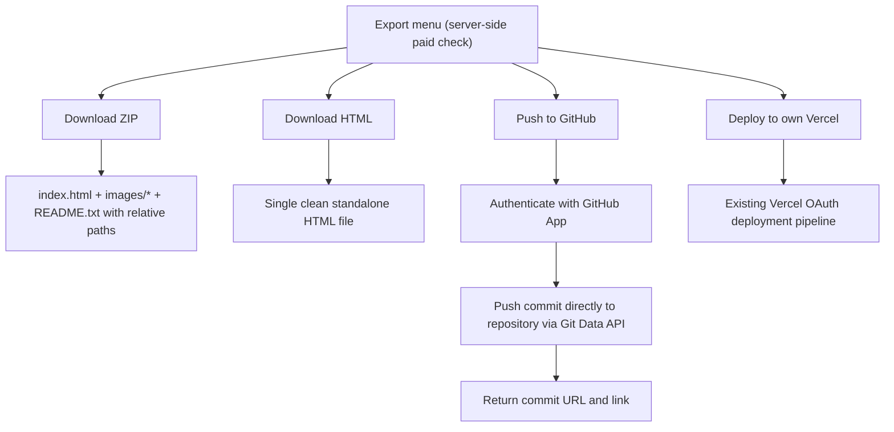

# User Flow: Current and Target Architecture

Status as of 2026-10-13.

- **Part 1** describes how the product works today, traced directly through the implemented code on `main`.
- **Part 2** describes the target architecture specified in `version2memory.md` section 6: three model generation paths, hosting on `name.<sites-domain>`, custom domain management, and paid exports.

---

# Part 1: Current flow (as built)

Publishing today deploys to **the user's own Vercel account** via OAuth. HTML and ZIP exports are gated behind `hasPaidAccess` (server-side 402 checks). Payments are processed exclusively via **Dodo Payments** ($19 one-time Pro unlock).

## Diagram: current user journey

## Diagram: generation request in detail

## Diagram: background data retention

## Stage 0: Landing page (`/`)
- `getLaunchMode()`: In waitlist mode (`VITE_LAUNCH_MODE=waitlist`), calls to action trigger an email submission to `POST /api/waitlist` which forwards to Google Apps Script. In live mode, CTAs route directly to `/login`.

## Stage 1: Sign up or log in (`/login`)
- Supabase Auth handles email/password registration and sign-in.
- Destination: redirect parameter if provided; otherwise queries `GET /api/content` and routes to `/studio` if content exists, else `/onboarding`.
- Global CSRF Origin verification in `src/start.ts` protects all state-changing endpoints.

## Stage 2: The 6-step wizard (`/onboarding`)
1. **Resume**: `POST /api/uploads` (kind `resume`, PDF/DOCX, 5 MB limit). Magic bytes sniffed, text extracted and saved to `resume_texts`.
2. **Visual style**: Up to 3 reference screenshots + Minimal/Bold intensity toggle.
3. **Profile photo**: Single image slot, metadata and GPS EXIF stripped via `sharp`.
4. **Links and specifics**: LinkedIn, GitHub, project links, free-text instructions saved to `portfolio_inputs`.
5. **Gemini key**: Saved to `byok_keys` with AES-256-GCM encryption.
6. **Generate**: `POST /api/generate` runs fact checking, HTML sanitization, version storage, and server-side watermarking.

## Stage 3: Studio (`/studio`)
- Preview displayed in an isolated iframe with `sandbox="allow-scripts"` (without `allow-same-origin`).
- Free users see the `data-shipfolio-watermark` banner injected by the server.
- Paid users have access to clean unwatermarked preview, HTML download (`GET /api/export/html`), ZIP download (`GET /api/export/zip`), and Vercel publishing.

## Stage 4: Payment (Dodo Payments only)
- One-time $19 lifetime Pro unlock via `POST /api/billing/checkout`.
- Webhook `POST /api/webhooks/dodo` validates standard HMAC signature and activates `users.plan = 'pro'`.
- Server evaluates `hasPaidAccess()` across all protected actions.

## Stage 5: Publish (to user's own Vercel)
- OAuth connection established via `GET /api/vercel/oauth/start` and callback.
- `POST /api/publish` requires paid access (402 if unpaid), bundles storage images locally, uploads file blobs, and triggers deployment on user's Vercel account.

## Stage 6: Data retention
- Hourly pg_cron job deletes resumes and reference screenshots 48 hours after generation.
- Daily pg_cron job purges photos and project images for drafts inactive after 30 days.

---

# Part 2: Proposed architecture (Version 2)

Key architectural updates:
1. **Three generation paths:** (A) Free model fallback chain, (B) User's own Claude/ChatGPT subscription via MCP server, (D) User's own Gemini key.
2. **Model-written HTML:** Every path produces a complete, bespoke HTML/CSS document directly (no templates, no JSON intermediate step).
3. **Subdomain hosting:** Sites published to `name.<sites-domain>` with Content Security Policy sandbox isolation.
4. **Custom domains:** Custom domain mapping and HTTPS provisioning via Vercel Domains API.
5. **Comprehensive export:** Clean ZIP, HTML, and direct GitHub App repository push.

## Diagram: proposed user journey

## Diagram: the shared pipeline (finalizeHtml)

## Diagram: path A (free models)

## Diagram: path B (Claude or ChatGPT via MCP)

## Diagram: publish, custom domain and serving

## Diagram: export (paid)

